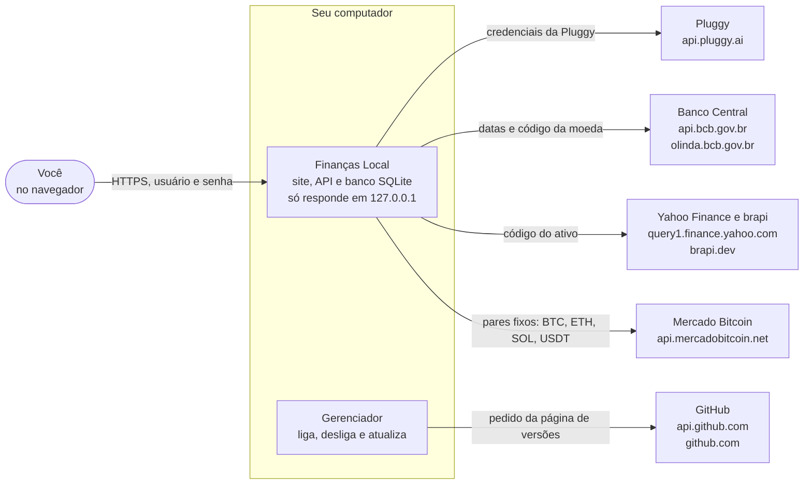
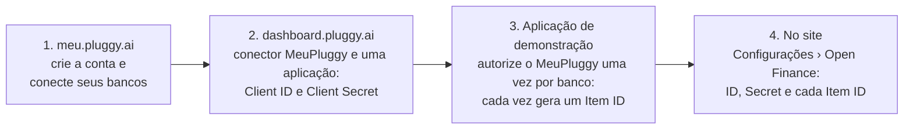
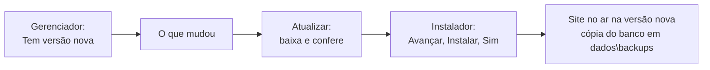

# Finanças Local

Seu controle financeiro pessoal, rodando **no seu computador**: transações, orçamentos, metas, contas a pagar, investimentos e relatórios. Os extratos dos bancos chegam sozinhos pelo **Open Finance** (via Meu Pluggy), e os seus dados **não saem do computador**.

- **Windows:** [instalador `.msi`](#instalar-no-windows), sem terminal nem programa nenhum antes.
- **Linux:** [um comando no terminal](#instalar-no-linux).
- **Já instalou?** O passo a passo de cada tela está no **Manual**, no menu do próprio site, e o botão **Ajuda** de cada tela abre a parte certa.

## Como funciona



Tudo o que sai vai por HTTPS; valores, quantidades e dados pessoais não saem. Detalhes em [Segurança](#segurança).

## Instalar no Windows

1. **Baixe** o `FinancasLocal-<versão>.msi` da [versão mais recente](https://github.com/LucasDesenvGit/financas-local/releases/latest).
2. **Abra o `.msi`.** Ele ainda não é assinado: se aparecer **"O Windows protegeu o computador"**, clique em **Mais informações › Executar assim mesmo**.
3. **Instale:** **Avançar**, **Instalar** e **Sim** quando o Windows pedir permissão de administrador.
4. **Termine** com **"Abrir o Gerenciador do Finanças Local"** marcado. Quando ele mostrar **"O site está no ar"**, clique em **Abrir o site** (ou abra **https://127.0.0.1:5443**).
5. **Primeiro acesso:** crie o seu usuário e senha (mínimo de 8 caracteres) e [conecte seus bancos](#conectar-seus-bancos-open-finance).

O **Gerenciador do Finanças Local** mostra se o site está no ar, liga, desliga, salva uma cópia do banco e avisa da versão nova. Conferir o arquivo baixado, versão de desenvolvimento e tudo o que o gerenciador faz: [Instalador e gerenciador](docs/INSTALADOR-E-GERENCIADOR.md).

## Instalar no Linux

Precisa de `git`, `curl`, `tar` e `unzip`. O resto (.NET, Go, Node.js, sqlite3) a instalação baixa e confere sozinha, sem `sudo`.

```bash
git clone https://github.com/LucasDesenvGit/financas-local.git
cd financas-local
scripts/geral/instalar.sh
```

O site vira um serviço do seu usuário (systemd) e fica em **https://localhost:5443**; no primeiro acesso, crie o usuário e a senha. O gerenciador entra no menu de aplicativos. Para o navegador confiar no certificado, a instalação mostra o comando da sua distribuição. Etapa por etapa, gerenciador e problemas: [Instalar a partir do código](docs/INSTALACAO-PELO-CODIGO.md).

## Conectar seus bancos (Open Finance)

Só instituições autorizadas pelo Banco Central acessam o Open Finance direto. Por isso o site usa o **Meu Pluggy**, gratuito para os dados do seu próprio CPF.



A primeira carga traz os últimos 365 dias; depois, o site sincroniza sozinho a cada 6 horas. O consentimento vale até 12 meses, e o Painel avisa 30 dias antes de vencer. O passo a passo está no capítulo **Conectar seus bancos** do Manual.

## O que tem

- **Painel:** como você está hoje e como está o mês.
- **Transações:** tudo o que entrou e saiu, com filtros, categorização em lote e lançamentos manuais.
- **Contas e cartões:** saldos, faturas e dívida de cada cartão.
- **Orçamentos, Metas e Contas a pagar:** limites por categoria, quanto guardar por mês e vencimentos.
- **Investimentos:** ações, FIIs, cripto, reservas e empréstimos, comparados com a Selic.
- **Relatórios, Visão anual e Projeção:** para onde foi o dinheiro, como foi o ano e quanto você vai ter.
- **Categorias e regras:** regras automáticas ("descrição contém UBER → Transporte").

Cada tela está explicada no **Manual** do site.

## Atualizar



Nenhuma atualização apaga dados, e o site fica fora do ar só por alguns segundos. Sem o gerenciador, baixe o `.msi` novo e abra. No Linux: `git pull` e `scripts/geral/3-publicar-atualizar.sh`. Voltar de versão e passar dos scripts para o `.msi`: [Instalador e gerenciador](docs/INSTALADOR-E-GERENCIADOR.md#atualizar).

## Desinstalar

No Windows: **Configurações › Aplicativos › Aplicativos instalados › Finanças Local › Desinstalar**. **Os seus dados ficam** em `C:\ProgramData\FinancasLocal\dados`; para apagá-los também, veja [Desinstalar](docs/INSTALADOR-E-GERENCIADOR.md#desinstalar). No Linux: [Parar e desinstalar](docs/INSTALACAO-PELO-CODIGO.md#parar-e-desinstalar).

## Segurança

- **Seus dados ficam no seu computador**, na pasta `dados`, que só a conta do serviço e os administradores acessam. O site só responde no próprio computador, por HTTPS, e pede usuário e senha.
- **O que sai para a internet** está no diagrama de [Como funciona](#como-funciona): só o mínimo, por HTTPS.
- **Segredos** (como o Client Secret da Pluggy) ficam criptografados, e o site nunca os devolve.
- **Recomendado:** criptografia do disco (BitLocker ou LUKS) e, de vez em quando, uma cópia do banco pelo gerenciador num disco externo.

A tabela completa do que sai e os detalhes técnicos (login, sessão, CSRF, cabeçalhos, auditoria): [docs/SEGURANCA.md](docs/SEGURANCA.md). O que é guardado, por quanto tempo e como apagar: [docs/DADOS-PESSOAIS.md](docs/DADOS-PESSOAIS.md).

## Problemas comuns

| Sintoma | O que fazer |
|---|---|
| O gerenciador diz "ligado, mas não responde" | Espere alguns segundos e clique em **Reiniciar** |
| O navegador alerta sobre o certificado | Abra o mesmo `.msi` e escolha **Reparar** |
| A sincronização falha com 401/403 | Confira o Client ID, o Secret e se o MeuPluggy foi autorizado para aquele banco |
| Perdi dados ou quero voltar a uma cópia do banco | Siga [Restaurar uma cópia](docs/OPERACAO.md#restaurar-uma-cópia) |
| Uma atualização não funcionou | Siga [Atualização que falhou](docs/OPERACAO.md#atualização-que-falhou) |
| Algo deu errado e não sei o quê | Veja **Configurações › Erros** |

Os outros, com mais detalhe: [Problemas comuns](docs/PROBLEMAS-COMUNS.md).

## Para quem desenvolve

- [Instalar a partir do código](docs/INSTALACAO-PELO-CODIGO.md): scripts, Visual Studio, testes e pastas.
- [CONTRIBUINDO.md](CONTRIBUINDO.md): branches, commits, versão e pull requests.
- [Arquitetura](docs/ARQUITETURA.md), [Banco de dados](docs/BANCO-DE-DADOS.md) e as [decisões (ADRs)](docs/adr/README.md).
- [UI/UX](docs/UI-UX.md): as referências (Nielsen, WCAG 2.2, Shneiderman) e os padrões de tela que o site segue.
- [CHANGELOG.md](CHANGELOG.md): o que mudou em cada versão.

Front-end em Angular e banco SQLite. A API em .NET 10 fica na frente e o back-end está passando para Go, um assunto de cada vez ([ADR 0049](docs/adr/0049-back-end-em-go-trocado-aos-poucos-atras-do-dotnet.md)). Tudo publicado junto, como serviço do sistema.
