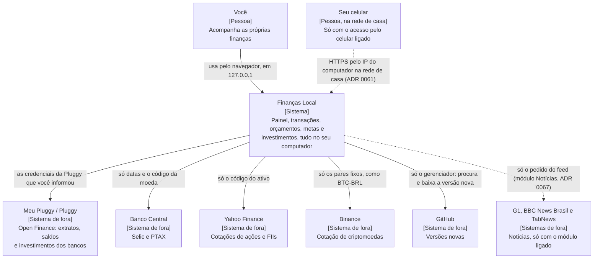
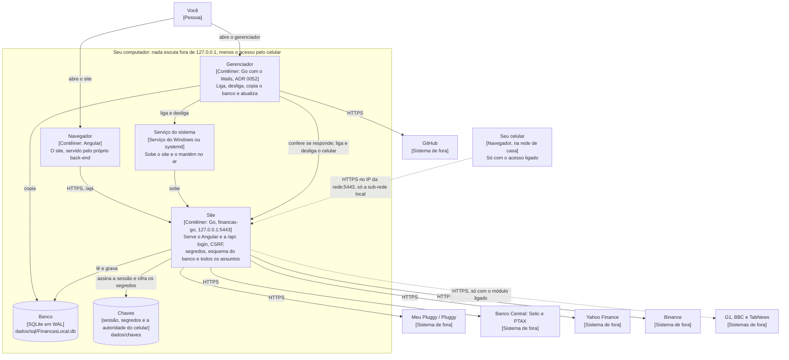
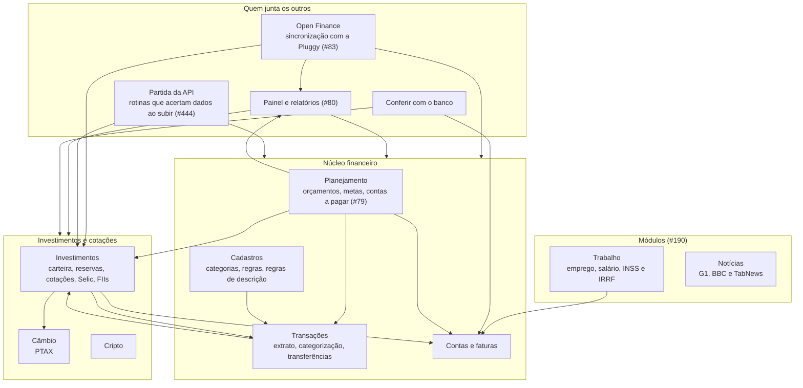
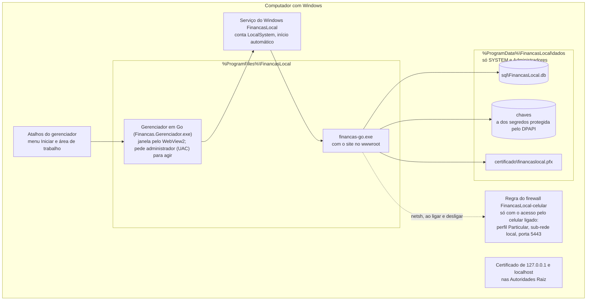
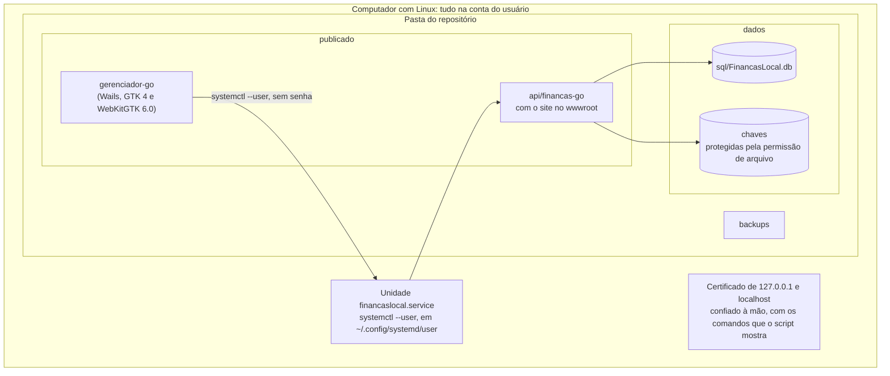
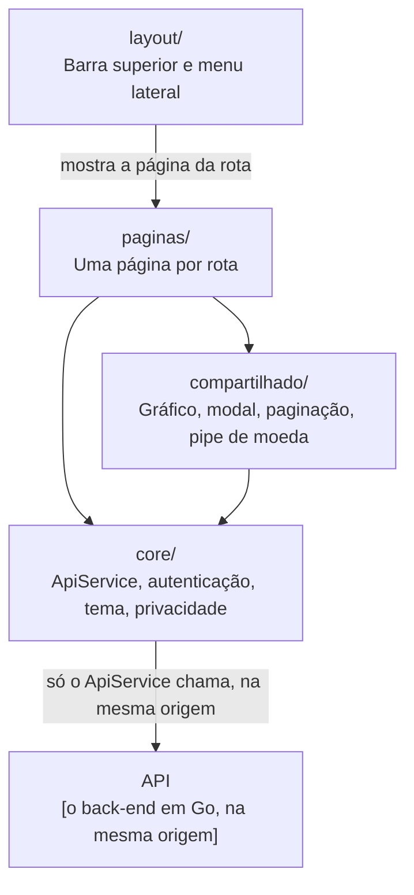

# Arquitetura

Esta página começa pela visão de cima (o **HLD**): quem usa o sistema, as partes dele, onde cada uma roda e o que sai do computador. O detalhe por pasta vem depois. O padrão dos diagramas está na [ADR 0055](adr/0055-documentacao-de-arquitetura-em-diagramas-mermaid.md).

> **Data dos diagramas:** 03/11/2026, sem o .NET (#86).

## Contexto

Quem usa, o que é o sistema e com quem ele fala (nível 1 do [modelo C4](https://c4model.com/)). Cada seta diz o que vai. Quantidades, valores e dados pessoais não saem do computador; a tabela completa está em [SEGURANCA.md](SEGURANCA.md#o-que-sai-para-a-internet).

## Contêineres

As partes que rodam e como conversam (nível 2 do C4). A fronteira é o computador: nada escuta fora de `127.0.0.1`, a não ser com o acesso pelo celular ligado ([ADR 0061](adr/0061-acesso-pelo-celular-na-rede-local.md)), que abre a porta só no IP da rede de casa.

Cada caixa, em uma frase:
- **Navegador:** o Angular é publicado no `wwwroot`, ao lado do executável do site: mesma origem, sem CORS, com cookies `__Host-` e CSRF simples.
- **Site:** um executável só, em Go (`financas-go`), que serve o Angular e a `/api` direto em HTTPS, sem IIS nem proxy, como serviço do sistema. Detalhes em [Back-end](#back-end--srcbackend); como se instala, em [Instalador](#instalador-do-windows--instalador) e [Scripts](#scripts--scripts).
- **Banco:** o acesso é a permissão do sistema operacional sobre a pasta `dados`.
- **Gerenciador:** roda como o usuário, fora do site.
- **Celular:** só com o acesso pelo celular ligado (Configurações › Segurança). O site abre um segundo servidor no IP escolhido da rede de casa, com o mesmo login e um certificado da autoridade local que o celular instala uma vez (`internal/plataforma/celular`).

O que sai para a internet e como o site se protege (login, sessão, CSRF, cabeçalhos, segredos): [SEGURANCA.md](SEGURANCA.md).

## Mapa de contextos

Os assuntos do back-end e quem usa quem. A seta vai de quem usa para quem é usado, e a seta para uma moldura quer dizer que ele usa vários assuntos de dentro.

- **A fonte do mapa** ([ADR 0056](adr/0056-arquitetura-do-codigo-go-camadas-por-assunto-e-ddd-estrategico.md)): a tabela `dependencias` do teste de arquitetura (`src/backend/internal/arquitetura/arquitetura_test.go`), par a par, com o motivo. Este diagrama agrupa os mesmos pares para quem lê, e muda quando muda uma seta entre os grupos. Para conferir: `go list -f '{{.ImportPath}} {{.Imports}}' ./internal/...`.
- **Planejamento × Painel:** os orçamentos e as contas a pagar leem a base dos relatórios (`internal/analises/relatorios`), e os orçamentos, os totais de empréstimos (`internal/patrimonio/emprestimos`).
- **Investimentos × Transações:** as duas setas existem. Investimentos lê os lançamentos e a categorização, e Transações usa as reservas para reconhecer transferências (`transferencias` importa `reservas`).
- **Fora do mapa:** tudo o que o back-end inteiro usa: login e sessão, parâmetros, erros do sistema, auditoria, banco e tipos.
- **Partida:** as sete rotinas que acertam dados ao subir o site (`internal/partida`, #444) só chamam a regra de cada assunto (categorização, transferências, cobranças, carteira), numa ordem fixa.
- **Núcleo × módulos** ([ADR 0064](adr/0064-modulos-compilados-no-executavel-e-ligados-no-banco.md)): módulo entra sem mexer no núcleo, mora em `internal/modulos/<id>` e se desliga em Configurações › Módulos; desligado, as rotas dele respondem 409 e as tarefas não rodam. O Trabalho ([ADR 0065](adr/0065-trabalho-emprego-salario-com-vigencia-e-tabelas-oficiais.md)) só lê o nome da conta onde o salário cai e não entra nos relatórios; o Notícias ([ADR 0067](adr/0067-noticias-g1-bbc-e-tabnews-so-com-o-modulo-ligado.md)) não usa o núcleo.

## Onde roda o quê

### Windows, pelo `.msi`

### Linux, pelos scripts

## Por dentro

O detalhe do que é estável hoje (o LLD), em diagramas:
- **[Componentes do site](arquitetura/componentes.md):** o nível 3 do C4, só do Go. Mostra os pacotes de `internal/` agrupados por papel, quem chama quem, onde fica a regra de cada assunto e as regras de dependência que o teste de arquitetura confere.
- **[Modelo de dados](BANCO-DE-DADOS.md#o-modelo-em-diagramas):** as tabelas por assunto, geradas do `01-estrutura.sql`.
- **[Fluxos principais](arquitetura/fluxos.md):** login e sessão, um pedido à API, partida do site, sincronização com a Pluggy e atualização pelo gerenciador.
- **[Domínio](arquitetura/dominio.md):** os estados da conexão, da transação, da conta a pagar e do gerenciador, as classes do centro do domínio e os termos usados no código.

## Índice da documentação

As 12 seções do [arc42](https://arc42.org/) e onde cada uma está. O índice só aponta: o conteúdo fica em cada documento. A lista dos arquivos, um por linha, está no [README da pasta](README.md).

| Seção | Onde está |
|---|---|
| 1. Introdução e objetivos | [README](../README.md) |
| 2. Restrições | [`CLAUDE.md`](../CLAUDE.md) e as [ADRs](adr/README.md) |
| 3. Contexto | [Contexto](#contexto), nesta página |
| 4. Estratégia | [ADRs](adr/README.md) |
| 5. Blocos | [Contêineres](#contêineres) e [Mapa de contextos](#mapa-de-contextos), nesta página, e os [Componentes do site](arquitetura/componentes.md) (nível 3 do C4) |
| 6. Execução | [Fluxos principais](arquitetura/fluxos.md) |
| 7. Implantação | [Onde roda o quê](#onde-roda-o-quê), nesta página |
| 8. Conceitos transversais | [Segurança](SEGURANCA.md), [modelo de ameaças](MODELO-DE-AMEACAS.md), [dados pessoais](DADOS-PESSOAIS.md), [erros](adr/0022-erros-do-sistema-gravados-no-banco.md), [domínio](arquitetura/dominio.md) e [testes](adr/0051-testes-do-back-end-em-go-cada-regra-com-teste.md). **Falta** o contrato da API (#472) |
| 9. Decisões | [ADRs](adr/README.md) |
| 10. Qualidade | [Requisitos não funcionais](REQUISITOS-NAO-FUNCIONAIS.md) |
| 11. Riscos e dívidas | [Modelo de ameaças](MODELO-DE-AMEACAS.md), a [#68](https://github.com/LucasDesenvGit/financas-local/issues/68) e as consequências das ADRs |
| 12. Glossário | [`glossario.ts`](../src/frontend/src/app/compartilhado/glossario/glossario.ts) e os [termos para quem desenvolve](arquitetura/dominio.md#termos-para-quem-desenvolve) |

## Back-end — `src/backend`

O site em Go ([ADR 0049](adr/0049-back-end-em-go-trocado-aos-poucos-atras-do-dotnet.md); detalhes no [README](../src/backend/README.md)).

- **Um executável só** (`cmd/financas`, `financas-go`): serve o Angular do `wwwroot` e a `/api`, em HTTPS em `127.0.0.1:5443`, como serviço do sistema (`internal/plataforma/servicosistema`: Serviço do Windows ou systemd). O `appsettings.json` (ao lado do executável) e o `appsettings.Production.json` (gerado pela instalação) dizem o banco, as chaves e o certificado.
- **Ao iniciar:** `-aplicar-esquema` cria ou atualiza o banco pelos scripts de `banco/` (embutidos no executável, com a cópia antes de mudar), e `-rotinas-de-partida` roda as sete rotinas que acertam dados (`internal/partida`, #444).
- **Login, sessão, CSRF e limite de tentativas:** do próprio Go (`internal/plataforma/autenticacao`, #75), na frente de todas as rotas.
- **Segredos** (o Client Secret da Pluggy): cifrados na tabela `Configuracao` (`internal/plataforma/segredos`); a cifra e a chave estão em [SEGURANCA.md](SEGURANCA.md#detalhes-técnicos).
- **Tarefas em segundo plano:** câmbio, cripto e a sincronização do Open Finance (`internal/plataforma/tarefas`).
- **Erros:** os avisos e erros do log vão para a tabela `ErroSistema` (Configurações › Erros, [ADR 0022](adr/0022-erros-do-sistema-gravados-no-banco.md); `internal/plataforma/erros`, #298).
- **Banco:** em WAL, no formato que o EF Core gravava (decimal, data e GUID como texto), para os bancos que já existem continuarem os mesmos ([README do banco](../src/backend/internal/plataforma/banco/README.md)). Consultas e dinheiro seguem as regras do [CLAUDE.md](../CLAUDE.md#convenções-de-código).
- **Datas** sempre no fuso de Brasília (`internal/plataforma/relogio`).
- **Testes:** cada regra com teste no pacote do assunto, e cada endpoint com o caso de contrato (`testes/contrato`); como, na [ADR 0051](adr/0051-testes-do-back-end-em-go-cada-regra-com-teste.md) e no [CONTRIBUINDO.md](../CONTRIBUINDO.md#testes-do-back-end-go).

O código fica num pacote por assunto em `internal/<area>/<assunto>` (são mais de 50), com HTTP, regra e banco dentro ([ADR 0056](adr/0056-arquitetura-do-codigo-go-camadas-por-assunto-e-ddd-estrategico.md)). As áreas são as das telas do front-end (`movimentacao`, `planejamento`, `patrimonio`, `analises`, `ajustes`), mais `openfinance` e `plataforma` (#656); a tabela está no [`internal/README.md`](../src/backend/internal/README.md#as-áreas). Os pacotes, agrupados em componentes, com quem chama quem, estão nos [Componentes do site](arquitetura/componentes.md). O padrão de um assunto está no [`internal/README.md`](../src/backend/internal/README.md). Os de infraestrutura:

| Pasta | O que tem |
|---|---|
| `cmd/financas` | O ponto de entrada (opções, ligação das peças) e o subcomando `preparar-https`. |
| `internal/api` | O `ServeMux` com as rotas de todos os assuntos: uma linha por assunto. |
| `internal/plataforma/servidor` | HTTPS local, arquivos do site, cabeçalhos de segurança (a CSP), erros e o certificado. |
| `internal/plataforma/autenticacao`, `internal/plataforma/sessao` | Login, sessão, CSRF e limite de tentativas; o usuário logado no contexto. |
| `internal/plataforma/banco` | SQLite em WAL, transação e o esquema ao iniciar. |
| `internal/plataforma/segredos` | Os segredos cifrados da `Configuracao`. |
| `internal/plataforma/tarefas` | As tarefas em segundo plano. |
| `internal/arquitetura` | O teste de arquitetura (só local): regra sem HTTP e o mapa de contextos. |
| `internal/plataforma/config`, `internal/plataforma/relogio`, `internal/plataforma/tipos`, `internal/plataforma/versao` | Configuração, fuso de Brasília, os tipos no formato do banco e versão. |

## Front-end — `src/frontend`

O caminho de uma tela até a API: a página chama um método do `ApiService`, que faz o pedido HTTP com o cookie de sessão e o token CSRF. Nenhum componente usa o `HttpClient` direto.

| Pasta | Responsabilidade |
|---|---|
| `src/app/core/` | `ApiService` (todas as chamadas HTTP), modelos (interfaces TypeScript), autenticação, tema, privacidade, avisos rápidos (`AvisosService`). |
| `src/app/compartilhado/` | O que duas ou mais partes usam ([ADR 0058](adr/0058-pastas-do-front-end-por-grupo-do-menu-e-por-assunto.md)): `ui/` sem assunto do domínio (modal, confirmação, paginação, lista suspensa, campos de data e de valor, [ADR 0032](adr/0032-controles-padrao-interruptor-e-campo-de-valor.md), ícones), `graficos/` (Chart.js), `bancos/`, `lancamentos/` e `glossario/`; na raiz, o pipe de moeda que respeita "ocultar valores" e as utilidades. |
| `src/app/layout/` | Estrutura da tela: barra superior e menu lateral, em grupos que abrem e fecham (`MENU` em `shell.component.ts`, [ADR 0046](adr/0046-menu-lateral-em-grupos-que-abrem-e-fecham.md)), e o que só ela usa (calculadora, notificações e os avisos do sino, menu do usuário, privacidade, status da sincronização). |
| `src/app/paginas/` | Uma subpasta por grupo do menu (`painel/`, `movimentacao/`, `planejamento/`, `patrimonio/`, `analises/`, `ajustes/`, `manual/`), com as telas, as abas e a lógica pura de cada uma ([ADR 0058](adr/0058-pastas-do-front-end-por-grupo-do-menu-e-por-assunto.md)); o `entrar.component.ts` fica na raiz. Página grande: componente da tela (estado e API), componentes de apresentação (`input()`/`output()`) e funções puras em `<tela>.ts` ([ADR 0059](adr/0059-paginas-grandes-divididas-em-tela-apresentacao-e-funcoes-puras.md)). |
| `src/styles.css` | Tema (tokens de cor claros/escuros) e componentes visuais globais. |
| `testes/` | Todos os testes do front-end, fora do build do Angular, com uma subpasta por ferramenta (#634). Na raiz, só o `rodar-afetados.mjs` (`npm run test:afetados`), que serve ao Jest e ao navegador. |
| `testes/jest/` | Testes com Jest ([ADR 0013](adr/0013-testes-do-front-end-com-jest.md)): `regressao/`, `usabilidade/` e `apoio/` (API falsa, abertura de telas pelo roteador). É a única pasta do `npm test` (`roots` do `jest.config.js`). |
| `testes/navegador/` | Testes no navegador com Playwright ([ADR 0041](adr/0041-testes-no-navegador-com-playwright.md)): o build de produção servido com a CSP da API (`servidor.mjs`), a API falsa (`api-falsa.ts`), as fixtures que tratam erro de console, exceção e bloqueio de CSP como falha (`base.ts`) e os prints sob demanda (`fotos.spec.ts`). |
| `testes/arquitetura/` | Teste de arquitetura (quem pode importar quem em `src/app`, #476). Só local: roda com `npm run test:arquitetura`, e nem o `npm test` nem a CI o rodam. |

Angular 22 com zone.js (`provideZoneChangeDetection`) e componentes standalone, todos com `ChangeDetectionStrategy.Eager`: várias telas guardam estado em campos comuns, e o OnPush, padrão do Angular 22, as deixaria sem atualizar.

## Instalador do Windows — `instalador/`

`.msi` gerado com o WiX 5 pela CI ([ADR 0029](adr/0029-instalador-msi-com-wix-gerado-pela-ci.md)); os arquivos, a ação personalizada e como gerar estão no [README da pasta](../instalador/README.md):
- **Conteúdo:** o site (`financas-go.exe`, com o Angular no `wwwroot`) e o gerenciador (`Financas.Gerenciador.exe`), os dois em Go sem cgo, em `%ProgramFiles%\FinancasLocal`. A janela do gerenciador precisa do WebView2: sem ele, o instalador avisa na tela final.
- **Dados:** em `%ProgramData%\FinancasLocal\dados`, que é o `Dados:Pasta` do `appsettings.Production.json` do pacote.
- **Serviço:** `FinancasLocal` (LocalSystem).
- **Onde baixar:** a versão publicada fica no Release `vX.Y.Z`. A do `develop` fica no pré-lançamento `desenvolvimento`, recriado a cada push depois dos testes. A mesma `X.Y.Z` substitui a instalada (`AllowSameVersionUpgrades`).

## Gerenciador — `src/gerenciador-go/`

App pequeno que mostra se o site está no ar, liga, desliga e reinicia o serviço e copia o banco. Roda como o usuário, fora do site ([ADR 0052](adr/0052-gerenciador-em-go-com-bandeja-e-pagina-local.md)). É um módulo Go à parte com o Wails v3: janela em HTML (pelo WebView2 no Windows, pelo GTK 4 e o WebKitGTK 6.0 no Linux) e ícone na bandeja. O `.msi` e os scripts o instalam. Veja o [README](../src/gerenciador-go/README.md).

## Scripts — `scripts/`

Separados por quem roda: `geral/` (bash), `windows/`, `linux/`, `dev/` e `ci/`. O Windows tem dois caminhos, o `.ps1` e o `.msi` ([ADR 0012](adr/0012-instalador-do-windows-em-powershell.md), [0029](adr/0029-instalador-msi-com-wix-gerado-pela-ci.md)). O que cada pasta e cada script fazem, e quem os roda (pessoa, CI ou gerenciador), está no índice único, o [scripts/README.md](../scripts/README.md).
