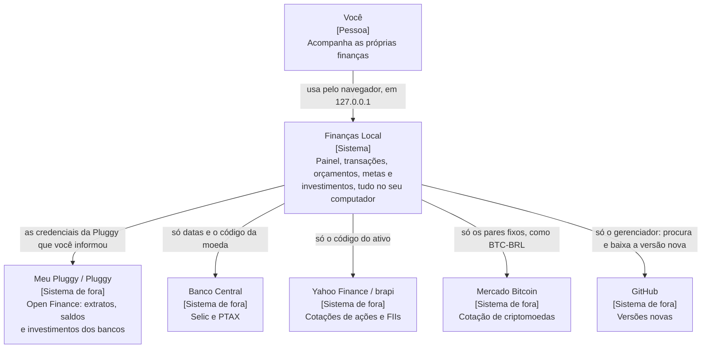
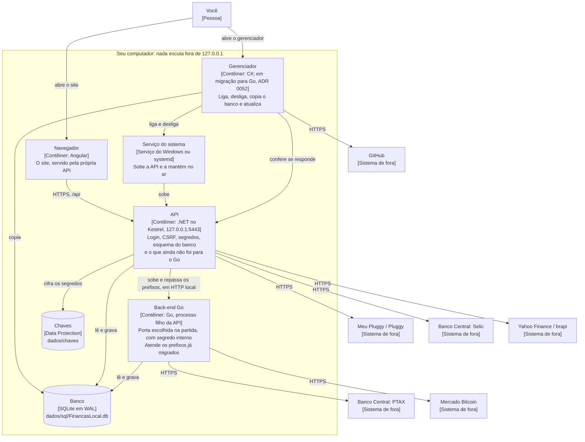
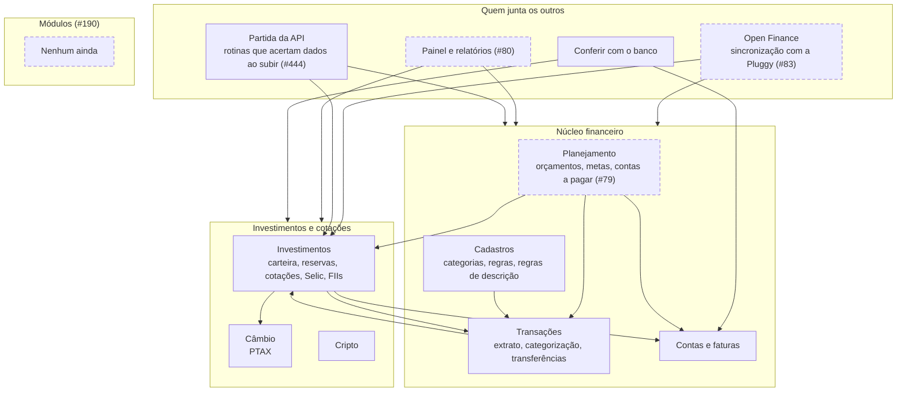
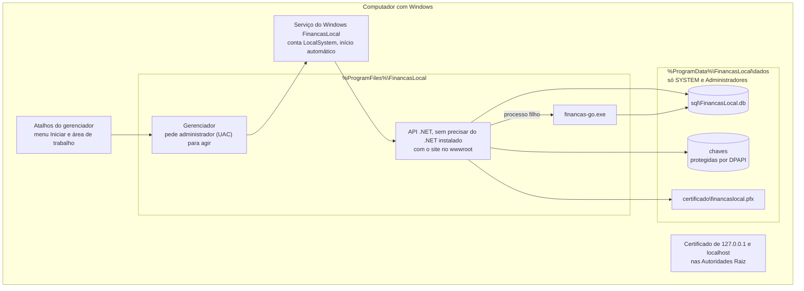
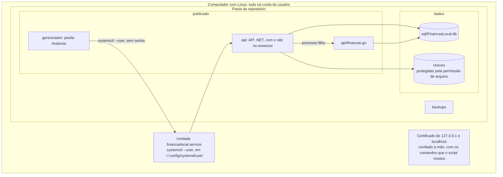
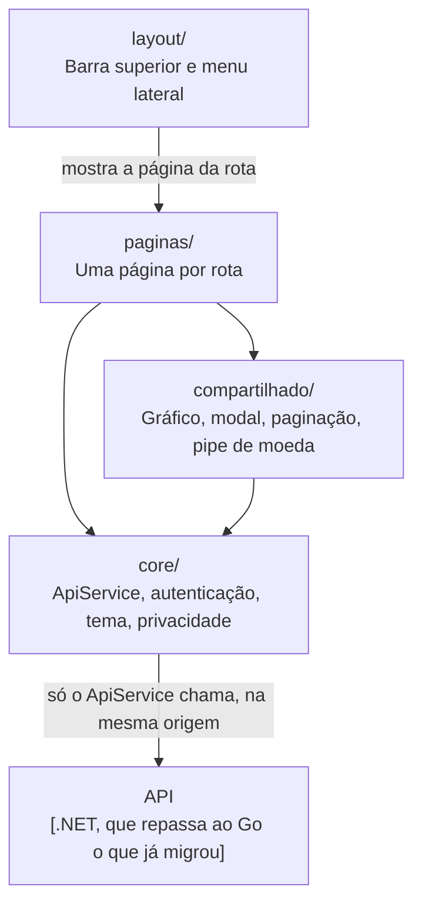

# Arquitetura

Esta página começa pela visão de cima (o **HLD**): quem usa o sistema, as partes dele, onde cada uma roda e o que sai do computador. O detalhe por pasta vem depois. O padrão dos diagramas está na [ADR 0055](adr/0055-documentacao-de-arquitetura-em-diagramas-mermaid.md).

> **Data dos diagramas:** 01/11/2026, na fase "Go atrás do .NET" (#231, [ADR 0049](adr/0049-back-end-em-go-trocado-aos-poucos-atras-do-dotnet.md)). Os diagramas de contêineres e de implantação mudam quando o .NET sair (#86).

## Contexto

Quem usa, o que é o sistema e com quem ele fala (nível 1 do [modelo C4](https://c4model.com/)). Cada seta diz o que vai. Quantidades, valores e dados pessoais não saem do computador; a tabela completa está em [SEGURANCA.md](SEGURANCA.md#o-que-sai-para-a-internet).



## Contêineres

As partes que rodam e como conversam (nível 2 do C4). A fronteira é o computador: nada escuta fora de `127.0.0.1`.



Cada caixa, em uma frase:
- **Navegador:** o Angular é publicado dentro da própria API (`wwwroot`), então site e API têm a mesma origem: sem CORS, cookies `__Host-` e proteção CSRF simples.
- **API:** sobe direto pelo Kestrel, sem IIS nem proxy, como serviço do sistema (`UseSystemd` no Linux e `UseWindowsService` no Windows). Os scripts bash são os mesmos nos dois (`scripts/geral/`, no Windows pelo Git Bash); o `instalar-windows.cmd` faz o mesmo sem bash, e o `.msi` instala sem precisar do código. Ao iniciar, ela aplica o esquema do banco, com uma cópia antes de mudar um banco existente.
- **Back-end Go:** a API o sobe como processo filho e repassa só os prefixos de `Go:Prefixos`, com o segredo interno e o Id de quem está logado. Login, CSRF e segredos continuam na API até a inversão (#85), e cada assunto volta para o .NET tirando o prefixo da lista. Detalhes em [Back-end em Go](#back-end-em-go--srcbackend-go).
- **Banco:** o mesmo arquivo para os dois back-ends. O acesso é a permissão do sistema operacional sobre a pasta `dados`.
- **Gerenciador:** roda como o usuário, fora da API.

O que sai para a internet e como o site se protege (login, sessão, CSRF, cabeçalhos, segredos): [SEGURANCA.md](SEGURANCA.md).

## Mapa de contextos

Os assuntos do back-end e quem usa quem. A seta vai de quem usa para quem é usado, e a seta para uma moldura quer dizer que ele usa vários assuntos de dentro. Borda tracejada: o assunto ainda está só no .NET.



- **A fonte do mapa** ([ADR 0056](adr/0056-arquitetura-do-codigo-go-camadas-por-assunto-e-ddd-estrategico.md)): a tabela `dependencias` do teste de arquitetura (`src/backend-go/internal/arquitetura/arquitetura_test.go`), par a par, com o motivo. Este diagrama agrupa os mesmos pares para quem lê, e muda quando muda uma seta entre os grupos.
- **Quando as setas foram conferidas:** nos pacotes em Go, pelos imports (`go list -f '{{.ImportPath}} {{.Imports}}' ./internal/...`). No que está só no .NET, pelos serviços que cada classe recebe no construtor (`SincronizacaoService`, `PainelController`, `RelatorioService` e `PlanejamentoControllers`).
- **Investimentos × Transações:** as duas setas existem. Investimentos lê os lançamentos e a categorização, e Transações usa as reservas para reconhecer transferências (`transferencias` importa `reservas`).
- **Fora do mapa:** tudo o que o back-end inteiro usa: login e sessão, parâmetros, erros do sistema, auditoria, banco e tipos. O Painel já tem partes em Go (`internal/relatorios`, `internal/emprestimos`), mas as rotas dele ainda são do .NET.
- **Partida:** as seis rotinas que acertam dados ao subir a API (`internal/partida`, #444) só chamam a regra de cada assunto (categorização, transferências, cobranças, carteira), na ordem do .NET. Estão em Go, mas só rodam com o Go na frente (depois da #85); até lá o .NET as roda.
- **Núcleo × módulos:** módulo é a visualização que entra sem mexer no núcleo e pode ser desligada (#190, #191). Ainda não há nenhum.

## Onde roda o quê

### Windows, pelo `.msi`



### Linux, pelos scripts



## Por dentro

O detalhe do que é estável hoje (o LLD), em diagramas:
- **[Modelo de dados](BANCO-DE-DADOS.md#o-modelo-em-diagramas):** as tabelas por assunto, geradas do `01-estrutura.sql`.
- **[Fluxos principais](arquitetura/fluxos.md):** login e sessão, pedido repassado ao Go, partida da API, sincronização com a Pluggy e atualização pelo gerenciador.
- **[Domínio](arquitetura/dominio.md):** os estados da conexão, da transação, da conta a pagar e do gerenciador, as classes do centro do domínio e os termos usados no código.

## Índice da documentação

As 12 seções do [arc42](https://arc42.org/) e onde cada uma está. O índice só aponta: o conteúdo fica em cada documento.

| Seção | Onde está |
|---|---|
| 1. Introdução e objetivos | [README](../README.md) |
| 2. Restrições | [`CLAUDE.md`](../CLAUDE.md) e as [ADRs](adr/README.md) |
| 3. Contexto | [Contexto](#contexto), nesta página |
| 4. Estratégia | [Decisões em resumo](#decisões-em-resumo), nesta página |
| 5. Blocos | [Contêineres](#contêineres) e [Mapa de contextos](#mapa-de-contextos), nesta página. **Falta** o nível 3 do Go (#464, depois da #86) |
| 6. Execução | [Fluxos principais](arquitetura/fluxos.md) |
| 7. Implantação | [Onde roda o quê](#onde-roda-o-quê), nesta página |
| 8. Conceitos transversais | [Segurança](SEGURANCA.md), [modelo de ameaças](MODELO-DE-AMEACAS.md), [dados pessoais](DADOS-PESSOAIS.md), [erros](adr/0022-erros-do-sistema-gravados-no-banco.md), [domínio](arquitetura/dominio.md) e [testes](adr/0051-testes-do-back-end-em-go-cada-regra-com-teste.md). **Falta** o contrato da API (#472, depois da #86) |
| 9. Decisões | [ADRs](adr/README.md) |
| 10. Qualidade | [Requisitos não funcionais](REQUISITOS-NAO-FUNCIONAIS.md) |
| 11. Riscos e dívidas | [Modelo de ameaças](MODELO-DE-AMEACAS.md), a [#68](https://github.com/LucasDesenvGit/financas-local/issues/68) e as consequências das ADRs |
| 12. Glossário | [`glossario.ts`](../src/frontend/src/app/compartilhado/glossario.ts) e os [termos para quem desenvolve](arquitetura/dominio.md#termos-para-quem-desenvolve) |

## Decisões em resumo

| Decisão | Por quê | ADR |
|---|---|---|
| Tudo local, sem exposição na rede | Os dados financeiros ficam no computador de quem usa | [0002](adr/0002-sqlite-e-kestrel-no-lugar-de-sql-server-e-iis.md) |
| Kestrel, sem IIS nem proxy | Os mesmos scripts no Windows e no Linux | [0002](adr/0002-sqlite-e-kestrel-no-lugar-de-sql-server-e-iis.md) |
| SQLite, sem migrations | O banco é um arquivo, e o esquema vem de scripts idempotentes | [0002](adr/0002-sqlite-e-kestrel-no-lugar-de-sql-server-e-iis.md), [0003](adr/0003-esquema-por-scripts-sql-idempotentes.md) |
| Site no `wwwroot` da API | Mesma origem: sem CORS, com cookies `__Host-` | [0004](adr/0004-front-end-publicado-no-wwwroot-da-api.md) |
| Código Go com as camadas dentro de cada assunto | Uma mudança num assunto fica num pacote; a regra não conhece HTTP; o mapa de contextos é conferido por teste | [0056](adr/0056-arquitetura-do-codigo-go-camadas-por-assunto-e-ddd-estrategico.md) |
| Go atrás do .NET | A troca acontece um assunto por vez, com volta fácil | [0049](adr/0049-back-end-em-go-trocado-aos-poucos-atras-do-dotnet.md) |
| CSP restritiva, sem script inline | Nada de terceiros carregado no site | [0034](adr/0034-sem-sri-no-build-do-front-end.md) |
| Saídas de rede só por HTTPS, com o mínimo de dados | Cada domínio novo pede uma ADR e entra na [tabela](SEGURANCA.md#o-que-sai-para-a-internet) | [0048](adr/0048-cotacao-de-criptomoedas-pelo-mercado-bitcoin.md), por exemplo |

## Back-end — `src/backend/Financas.Api`

| Pasta | Responsabilidade |
|---|---|
| `Controllers/` | Endpoints REST (`/api/...`). Finos: validam a entrada e chamam os serviços. `BaseController` padroniza erros. Um controller pode reunir recursos relacionados (ex.: `PlanejamentoControllers.cs` com orçamentos, metas e contas a pagar). |
| `Servicos/` | Regras de negócio. `RelatorioService` (painel, orçamentos, projeção, visão anual), `CategorizacaoService` (regras automáticas), `SugestaoCategoriaService` (sugestões pelo histórico), `SugestaoContaAgendadaService` (contas a pagar recorrentes achadas no extrato), `ContaService` (saldos, faturas do mês dos cartões), `AssistenteMetasService` (caixa mês a mês para o plano das metas: receitas − despesas − faturas que vencem; a divisão entre as metas fica no front-end, em `metas-plano.ts`, [ADR 0035](adr/0035-plano-das-metas-pelo-caixa-calculado-na-tela.md)), `BancoService` (banco de cada conta: catálogo e detecção pelo nome, [ADR 0024](adr/0024-banco-de-cada-conta-com-selo-local.md)), `TipoLancamentoService` (tipo de cada lançamento: Pix, compra no cartão, pagamento de fatura…, [ADR 0025](adr/0025-tipo-de-lancamento-pelo-open-finance-e-descricao.md)), `EmprestimoService` (empréstimos e financiamentos), `ConfiguracaoService`, `AuditoriaService`, `Relogio` (fuso de Brasília). |
| `Servicos/Pluggy/` | Cliente HTTP da Pluggy (sem SDK), modelos e sincronização (agendada pelo `SincronizacaoHostedService`). |
| `Servicos/Investimentos/` | Carteira de renda variável, cotações (`CotacaoService`), Selic (`SelicService`), FIIs (`FiiService`), importação pelo extrato (`ExtratoCarteiraService`), conferência com a corretora e o extrato (`ConferenciaInvestimentosService`, ADR 0027; o troco "sem dúvida" é classificado depois da sincronização, ADR 0044) reservas estimadas pelo extrato (`ReservaService`, que também estima o Méli Dólar em dólar, ADR 0038) e o histórico de saldo dos investimentos do Open Finance, com o rendimento de cada mês (`HistoricoInvestimentosService`, tabela `HistoricoInvestimento`, ADR 0045). |
| `Servicos/Cambio/` | Cotação PTAX de moedas estrangeiras (`CambioService`), guardada no banco para uso offline e atualizada pelo `CambioHostedService`. |
| `Servicos/Cripto/` | Cotação de criptomoedas em reais pelo Mercado Bitcoin (`CriptoService`, ADR 0048), guardada no banco por 30 dias e atualizada a cada 30 minutos pelo `CriptoHostedService`. |
| `Servicos/Diagnostico/` | Erros do sistema ([ADR 0022](adr/0022-erros-do-sistema-gravados-no-banco.md)): `RegistroErrosLoggerProvider` (avisos e erros do `ILogger` das classes `Financas.*`), `FilaErros`, `GravadorErrosHostedService` (grava na tabela `ErroSistema`, agrupa repetições e apaga os antigos) e `Sanitizador` (tira tokens, senhas, CPF e valores antes de gravar). |
| `Entidades/` | Classes mapeadas no EF Core. |
| `Data/FinancasDbContext.cs` | Mapeamento das tabelas (nomes, tamanhos, precisão, índices) — em sincronia manual com `banco/01-estrutura.sql`. |
| `Dtos/` | Contratos de entrada e saída da API (arquivo único `Dtos.cs`). |
| `Seguranca/` | Cabeçalhos de segurança (CSP), validação de sessão, constantes de cookies. |
| `Servicos/Go/` | Convivência com o Go (#231): `OpcoesGo` (`Go:Prefixos`, `Go:Tarefas`, `Go:Executavel`), `ProcessoGo` (sobe, vigia e para o processo filho; log do Go na categoria `Financas.Go`), `RepasseGo` (o endpoint que repassa os prefixos, com o login e o CSRF conferidos) e `JobObjectWindows`. |

Decisões (o porquê de cada uma, com alternativas e custos, está nas [ADRs](adr/README.md)):
- **SQLite + Kestrel**, sem SQL Server nem IIS ([ADR 0002](adr/0002-sqlite-e-kestrel-no-lugar-de-sql-server-e-iis.md)).
- **Sem migrations.** O banco é criado e atualizado por scripts SQL idempotentes ([ADR 0003](adr/0003-esquema-por-scripts-sql-idempotentes.md); passo a passo em [BANCO-DE-DADOS.md](BANCO-DE-DADOS.md)).
- **Front-end no `wwwroot` da API**, mesma origem ([ADR 0004](adr/0004-front-end-publicado-no-wwwroot-da-api.md)).
- **Cliente HTTP próprio** para a Pluggy e as demais integrações ([ADR 0006](adr/0006-cliente-http-proprio-para-a-pluggy.md)).
- **Câmbio pela PTAX** do Banco Central, guardado no banco para uso offline ([ADR 0007](adr/0007-cotacao-de-cambio-pela-ptax-do-banco-central.md)). Só investimentos respeitam moeda estrangeira; o resto é em reais ([ADR 0008](adr/0008-moeda-estrangeira-somente-em-investimentos.md)).
- **Reservas** (cofrinhos do Mercado Pago): quando a instituição informa pelo Open Finance o valor de uma reserva pelo nome, ele vale; as outras são estimadas pelos lançamentos "Dinheiro reservado/retirado" do extrato, com conferência manual opcional do saldo real, e, quando a instituição manda só o total, o que ele passa da soma delas aparece como "Reservado" ([ADR 0037](adr/0037-reservas-pelo-valor-do-open-finance.md), que substituiu a [0010](adr/0010-reservas-estimadas-pelo-extrato.md)).
- **Consultas só com LINQ/lambda** sobre entidades mapeadas; atualizações em massa com `ExecuteUpdate`/`ExecuteDelete`.
- **Segredos** (Client Secret da Pluggy, token da brapi) ficam criptografados na tabela `Configuracao` com Data Protection. Chaves em `dados/chaves`: protegidas por DPAPI no Windows e por permissão de arquivo no Linux ([ADR 0005](adr/0005-segredos-criptografados-com-data-protection.md)).
- **Datas** sempre no fuso de Brasília (`Relogio`).
- **Acesso ao banco** é só permissão de arquivo do sistema sobre `dados/`: o SQLite não tem login nem usuário; quem lê e grava é o processo da API, rodando com a conta do serviço. Não há senha de banco em lugar nenhum.

## Back-end em Go — `src/backend-go`

A API em Go que substitui o .NET aos poucos (épico #70, [ADR 0049](adr/0049-back-end-em-go-trocado-aos-poucos-atras-do-dotnet.md); detalhes no [README](../src/backend-go/README.md)). O mesmo executável (`cmd/financas`) roda no site atrás do .NET e, depois da inversão (#85), na frente.

- **Quem sobe o Go:** o .NET, como processo filho (`ProcessoGo`), depois do `EsquemaBanco` e das rotinas de partida. Continua um serviço só (systemd, Serviço do Windows, `.msi`). O executável `financas-go` fica ao lado da API.
- **Repasse:** os prefixos de `Go:Prefixos` (no `appsettings.json`, uma entrada por assunto, com os prefixos separados por `;`) vão ao Go com o método, o caminho, a query, o corpo e os cabeçalhos, menos o cookie e o token CSRF. Prefixo fora da lista continua no .NET; esvaziar a entrada de um assunto e reiniciar o serviço o devolve ao .NET.
- **Confiança:** o Go escuta só em `127.0.0.1`, numa porta escolhida na partida (em HTTP: a conversa não sai do computador). Sem o segredo interno, gerado a cada partida e passado pela entrada padrão, ele responde 401. O Id de quem está logado vai no cabeçalho `X-Financas-Usuario`, que o .NET apaga quando vem de fora.
- **Parada:** a entrada padrão do Go fica aberta enquanto o .NET vive; quando ela fecha (o .NET parou ou caiu), o Go para. No Windows, um Job Object com "matar ao fechar" garante isso mesmo com o Go travado. Se o Go cair, as rotas dele respondem 503 e o .NET o inicia de novo.
- **Banco:** o mesmo arquivo, em WAL (o `EsquemaBanco` passa o banco para WAL ao iniciar), com espera de banco ocupado nos dois lados e transações curtas. O Go grava no formato do EF Core e não aplica esquema.
- **Tarefas em segundo plano:** quando um assunto passa para o Go, a tarefa dele sai do .NET por `Go:Tarefas` (`Sincronizacao`, `Cambio`, `Cripto`).
- **No site hoje:** o Go atende o câmbio e a cripto (`/api/cambio`, `/api/cripto`) e roda as tarefas dos dois (#81), os cadastros: categorias, regras de categorização, regras de descrição e contas (`/api/categorias`, `/api/regras`, `/api/regras-descricao`, `/api/contas`; #77), as transações (`/api/transacoes`, as 18 rotas da tela de Transações; #78), e o planejamento: contas a pagar, orçamentos e metas (`/api/contas-agendadas`, `/api/orcamentos`, `/api/metas`, as 23 rotas; #79, #555). A conferência com o banco (`/api/conferencia-banco`, #445) também, em `internal/conferenciabanco`, lendo as reservas e a carteira de Go. O resto continua no .NET.
- **Erros:** o Go escreve o log em JSON na saída de erro, e o .NET registra cada linha na categoria `Financas.Go` (avisos e erros vão para Configurações › Erros, ADR 0022).
- **Testes** ([ADR 0051](adr/0051-testes-do-back-end-em-go-cada-regra-com-teste.md)): cada regra tem teste unitário em tabela no pacote do assunto, além do caso de contrato do endpoint (`testes/contrato`, #72). Consultas se testam num SQLite de verdade num arquivo temporário, com o esquema real; handlers, com `httptest`. Só a biblioteca padrão, sem asserção nem mock de terceiros. O C# continua sem teste automatizado.

| Pasta | O que tem |
|---|---|
| `cmd/financas` | O ponto de entrada: `-atras-do-dotnet` (como roda no site) ou sozinho (esqueleto da #73). |
| `internal/api` | O `ServeMux` com as rotas de todos os assuntos em Go. |
| `internal/servidor` | HTTPS local, cabeçalhos, erros e o modo atrás do .NET (segredo interno, usuário). |
| `internal/banco` | SQLite no formato do EF Core, transação, consultas do `sqlc`. |
| `internal/saude` | `GET /api/go/saude`, o exemplo que passa pelo caminho todo. |
| `internal/config`, `internal/relogio`, `internal/sessao`, `internal/tipos`, `internal/versao` | Configuração, fuso de Brasília, usuário logado, tipos do EF Core e versão. |

## Front-end — `src/frontend`



O caminho de uma tela até a API: a página chama um método do `ApiService`, que faz o pedido HTTP com o cookie de sessão e o token CSRF. Nenhum componente usa o `HttpClient` direto.

| Pasta | Responsabilidade |
|---|---|
| `src/app/core/` | `ApiService` (todas as chamadas HTTP), modelos (interfaces TypeScript), autenticação, tema, privacidade. |
| `src/app/compartilhado/` | Componentes reutilizáveis: gráfico (Chart.js), modal, paginação, calculadora, pipe de moeda que respeita "ocultar valores", campo de valor em dinheiro (`app-campo-valor`, [ADR 0032](adr/0032-controles-padrao-interruptor-e-campo-de-valor.md)). |
| `src/app/layout/` | Estrutura da tela: barra superior e menu lateral, em grupos que abrem e fecham (`MENU` em `shell.component.ts`, [ADR 0046](adr/0046-menu-lateral-em-grupos-que-abrem-e-fecham.md)). |
| `src/app/paginas/` | Uma página por rota. |
| `src/styles.css` | Tema (tokens de cor claros/escuros) e componentes visuais globais. |
| `testes-navegador/` | Testes no navegador com Playwright ([ADR 0041](adr/0041-testes-no-navegador-com-playwright.md)): o build de produção servido com a CSP da API (`servidor.mjs`), a API falsa (`api-falsa.ts`), as fixtures que tratam erro de console, exceção e bloqueio de CSP como falha (`base.ts`) e os prints sob demanda (`fotos.spec.ts`). |
| `testes/` | Testes com Jest ([ADR 0013](adr/0013-testes-do-front-end-com-jest.md)): `regressao/`, `usabilidade/` e `apoio/` (API falsa, abertura de telas pelo roteador). Fora do build do Angular. |

Angular 22 com zone.js (`provideZoneChangeDetection`) e componentes standalone. Todo componente declara `changeDetection: ChangeDetectionStrategy.Eager` — o comportamento padrão até o Angular 21 —, porque várias telas guardam estado em campos comuns e não em signals; o padrão OnPush do Angular 22 deixaria essas telas sem atualizar.

## Ferramentas — `src/backend/Financas.MigrarSqlite`

Migra os dados de uma instalação antiga (SQL Server/IIS) para o SQLite. É seguro rodar sem SQL Server disponível: sem nada para migrar, termina sem erro. O Client Secret da Pluggy e o token da brapi são limpos na migração (foram criptografados com as chaves da instalação antiga) e precisam ser informados de novo.

```bash
dotnet run --project src/backend/Financas.MigrarSqlite -- "<connection string SQL Server origem>" "<caminho .db destino>"
```

## Instalador do Windows — `instalador/`

`.msi` gerado com o WiX 5 pela CI (`.github/workflows/versao.yml`; [ADR 0029](adr/0029-instalador-msi-com-wix-gerado-pela-ci.md)):
- **Conteúdo:** API e gerenciador já compilados (self-contained `win-x64`) e o back-end em Go (`financas-go.exe`, sem cgo) em `%ProgramFiles%\FinancasLocal`.
- **Dados:** em `%ProgramData%\FinancasLocal\dados`, que é o `Dados:Pasta` do `appsettings.Production.json` do pacote.
- **Serviço:** `FinancasLocal` (LocalSystem).
- **Ação personalizada (`configurar.ps1`):** pasta de dados protegida, migração da instalação pelos scripts, certificado HTTPS e `configuracao.json`.
- **Gerar o pacote:** `gerar-msi.ps1` (`-Revisao N` para a versão de desenvolvimento `X.Y.Z-dev.N`).
- **Onde baixar:** a versão publicada fica no Release `vX.Y.Z`. A do `develop` fica no pré-lançamento `desenvolvimento`, recriado a cada push depois dos testes. A mesma `X.Y.Z` substitui a instalada (`AllowSameVersionUpgrades`).
- **Gerenciador:** `src/gerenciador/Financas.Gerenciador` ([ADR 0028](adr/0028-gerenciador-do-windows-e-atualizacao-pelo-github.md)).

## Gerenciador — `src/gerenciador/`

App pequeno que mostra se o site está no ar, liga, desliga e reinicia o serviço e copia o banco. Roda como o usuário, fora da API ([ADR 0028](adr/0028-gerenciador-do-windows-e-atualizacao-pelo-github.md), [ADR 0033](adr/0033-gerenciador-no-linux-com-avalonia.md)).

| Projeto | O que tem |
|---|---|
| `Financas.Gerenciador.Nucleo` (`net10.0`) | O que vale nos dois sistemas: `Instalacao` (pasta da API pelo serviço, banco e endereço pelo `appsettings`), `VerificadorSituacao` (serviço + `GET /api/auth/estado`), `CopiaDoBanco` (`VACUUM INTO`) e o serviço do sistema (`ServicoWindows`, `ServicoLinux`). |
| `Financas.Gerenciador` (WinForms) | Janela do Windows. Pede administrador (UAC) para ligar, desligar e copiar o banco, e atualiza pelo `.msi` do GitHub Releases. Vai no `.msi` ou pelo `scripts\windows\instalar-gerenciador.ps1`. |
| `Financas.Gerenciador.Linux` (Avalonia) | Janela do Linux. Usa o `systemctl --user` sem senha, mostra o registro do serviço (journald) e o comando para atualizar pelos scripts. Vai pelo `scripts/linux/instalar-gerenciador.sh`. |

**Em migração para Go** ([ADR 0052](adr/0052-gerenciador-em-go-com-bandeja-e-pagina-local.md), #418 a #420): `src/gerenciador-go/`, um módulo Go à parte com o Wails v3 (janela em HTML pelo WebView2, ícone na bandeja). Funciona no Windows e no Linux (no Linux, com o `systemctl --user`, GTK 4 e WebKitGTK 6.0; #417); ainda não é instalado. Veja o [README](../src/gerenciador-go/README.md).

## Scripts — `scripts/`

Separados pelo sistema em que rodam (#154): `geral/` é o bash que roda nos dois (no Windows, pelo Git Bash/MSYS ou WSL); `windows/` e `linux/` têm o que só funciona num deles. No Windows, a instalação também tem uma versão em PowerShell que dispensa o bash ([ADR 0012](adr/0012-instalador-do-windows-em-powershell.md)). Os `.cmd` (`instalar-windows.cmd`, `parar-windows.cmd`) ficam na raiz, porque são a porta de entrada de quem não usa terminal.

| Script | Função |
|---|---|
| `geral/instalar.sh` | Roda as etapas 1, 2 e 3 em sequência e para no primeiro erro. |
| `geral/1-preparar-ambiente.sh` | Confere as ferramentas básicas do terminal; instala Node.js LTS, .NET 10 SDK, Go (a linha do `src/backend-go/go.mod`) e, se o sistema não tiver, `sqlite3` portáteis em `ferramentas/` (reaproveita um `dotnet` 10.x, um `go` da mesma linha e um `sqlite3` do PATH). Não depende de Python ([ADR 0011](adr/0011-ferramentas-de-instalacao-portateis-sem-python.md)). |
| `geral/2-criar-banco.sh` | Cria as pastas de `dados/` com permissão restrita e aplica os arquivos de `banco/` em ordem. Também é lido pela API (embutido no build, `EsquemaBanco`) e pelo `instalar-windows.ps1`, que tiram dele a lista de colunas novas. |
| `geral/3-publicar-atualizar.sh` | Compila front, API e o back-end em Go (`financas-go`, ao lado da API), publica em `publicado/api`, gera/reaproveita o certificado HTTPS local e registra o serviço (systemd `--user` no Linux, `sc.exe` no Windows). |
| `geral/4-backup.sh` | Backup online do banco (`sqlite3 .backup`), com retenção e opção de agendar. |
| `geral/atualizar.sh`, `windows/atualizar-windows.ps1` | Só na instalação de desenvolvimento (clone na branch `develop`, ADR 0040): trazem o `develop` (só avançam, recusam com alteração local ou outra branch) e reinstalam. Chamados pelo botão do gerenciador. |
| `geral/parar.sh` | Para o serviço, a API fora dele e o `npm start`; no Git Bash, repassa para o `windows/parar-windows.ps1`. |
| `geral/comum.sh` | Funções compartilhadas pelos scripts (detecção de SO, pastas, `sqlite3` portátil no PATH, caminho nativo no Windows, extração de `.zip`, conferência de hash, helpers de coluna do banco). |
| `windows/instalar-windows.ps1` | Etapas 1, 2 e 3 no Windows PowerShell 5.1, sem bash; chamado por `instalar-windows.cmd` (na raiz), que pede elevação. Lê a lista de colunas novas do `geral/2-criar-banco.sh`. Mudanças nas etapas 1 e 3 do bash precisam ser refletidas aqui. |
| `windows/parar-windows.ps1` | O `parar.sh` em PowerShell; chamado por `parar-windows.cmd` (na raiz). |
| `windows/instalar-gerenciador.ps1`, `linux/instalar-gerenciador.sh` | Opcionais, sem administrador/root: publicam o gerenciador em `publicado/gerenciador` e criam os atalhos (Menu Iniciar no Windows, menu de aplicativos no Linux, e a área de trabalho). Rodar de novo atualiza o gerenciador. |
| `windows/configurar-github.ps1` | Cria o repositório no GitHub, envia as branches e aplica as proteções. |
| `ci/verificar-sql.py`, `ci/verificar-manual.py`, `ci/verificar-versao.py`, `ci/verificar-tempo-testes.py` | Usados na CI: banco idempotente e sem T-SQL, aviso de Manual desatualizado, versão subiu (ADR 0039) e tempo dos testes do Jest (#204). |
| `3-publicar-atualizar.sh`, `4-backup.sh`, `instalar-gerenciador.sh` (na raiz de `scripts/`) | **Repasses temporários** para os caminhos novos: o backup agendado antes da mudança e o comando que o gerenciador do Linux antigo mostra continuam funcionando. Podem ser apagados numa versão futura. |
