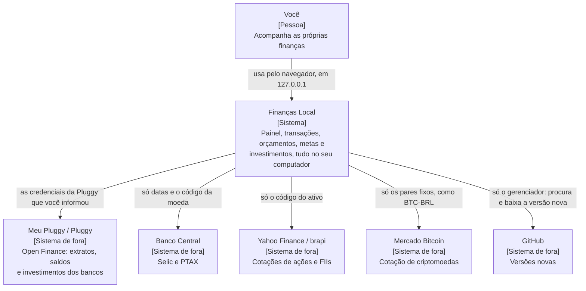
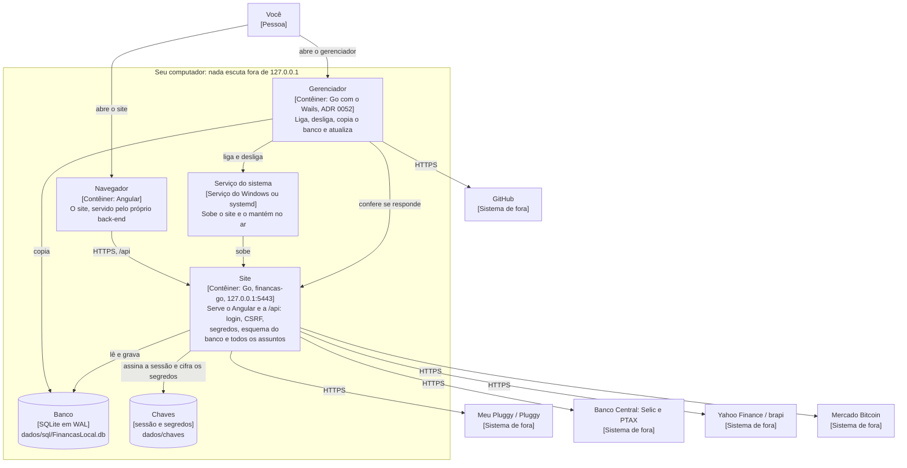
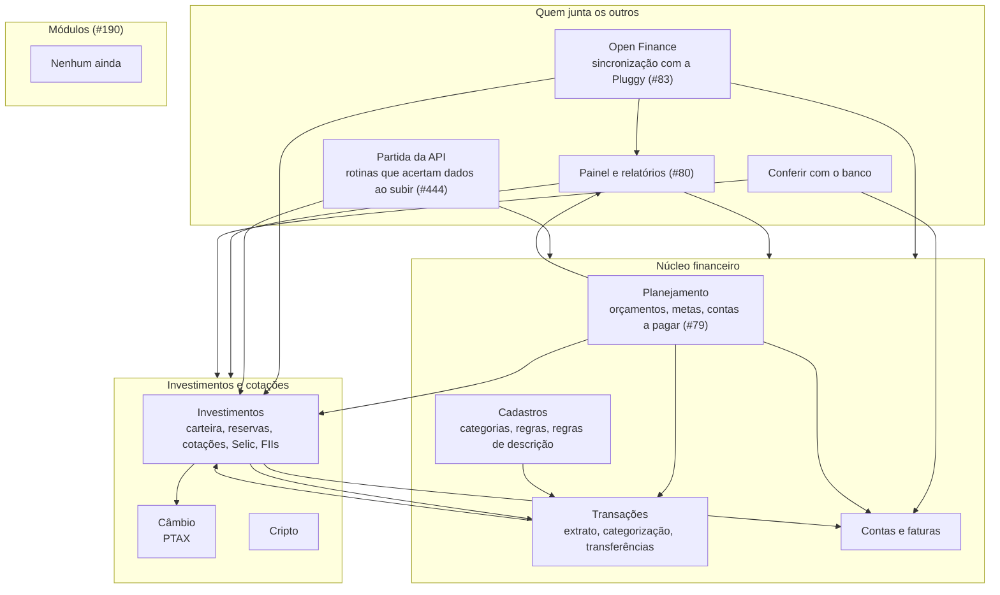
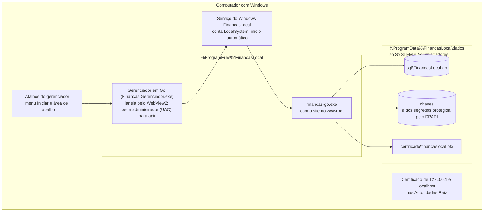
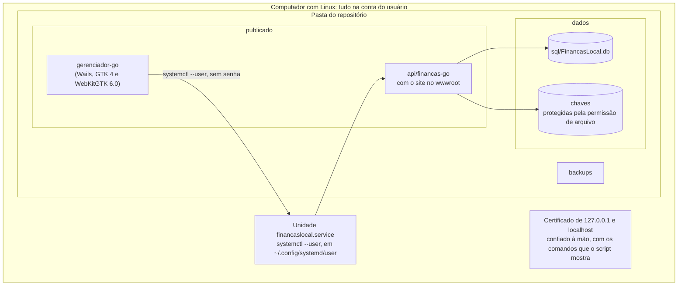
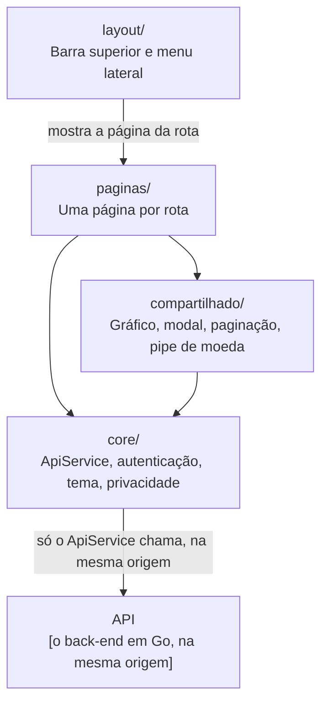

# Arquitetura

Esta página começa pela visão de cima (o **HLD**): quem usa o sistema, as partes dele, onde cada uma roda e o que sai do computador. O detalhe por pasta vem depois. O padrão dos diagramas está na [ADR 0055](adr/0055-documentacao-de-arquitetura-em-diagramas-mermaid.md).

> **Data dos diagramas:** 03/11/2026, com o .NET já fora (#86): o site é um executável só, em Go ([ADR 0049](adr/0049-back-end-em-go-trocado-aos-poucos-atras-do-dotnet.md)).

## Contexto

Quem usa, o que é o sistema e com quem ele fala (nível 1 do [modelo C4](https://c4model.com/)). Cada seta diz o que vai. Quantidades, valores e dados pessoais não saem do computador; a tabela completa está em [SEGURANCA.md](SEGURANCA.md#o-que-sai-para-a-internet).

## Contêineres

As partes que rodam e como conversam (nível 2 do C4). A fronteira é o computador: nada escuta fora de `127.0.0.1`.

Cada caixa, em uma frase:
- **Navegador:** o Angular é publicado no `wwwroot`, ao lado do executável do site, então site e API têm a mesma origem: sem CORS, cookies `__Host-` e proteção CSRF simples.
- **Site:** um executável só, em Go (`financas-go`), que serve o Angular e a `/api` direto em HTTPS, sem IIS nem proxy, como serviço do sistema (Serviço do Windows ou systemd). Ao iniciar (`-aplicar-esquema -rotinas-de-partida`), aplica o esquema do banco, com uma cópia antes de mudar um banco existente, e roda as rotinas que acertam dados. Os scripts bash (`scripts/geral/`) instalam no Linux; no Windows, a instalação é o `instalar-windows.ps1` (pelo `instalar-windows.cmd` ou pelo Git Bash, que repassa para ele), e o `.msi` instala sem precisar do código. Até a 3.0, havia uma API em .NET na frente e o Go atrás dela ([ADR 0049](adr/0049-back-end-em-go-trocado-aos-poucos-atras-do-dotnet.md)); o .NET saiu na #86. Detalhes em [Back-end](#back-end--srcbackend).
- **Banco:** o acesso é a permissão do sistema operacional sobre a pasta `dados`.
- **Gerenciador:** roda como o usuário, fora do site.

O que sai para a internet e como o site se protege (login, sessão, CSRF, cabeçalhos, segredos): [SEGURANCA.md](SEGURANCA.md).

## Mapa de contextos

Os assuntos do back-end e quem usa quem. A seta vai de quem usa para quem é usado, e a seta para uma moldura quer dizer que ele usa vários assuntos de dentro. Todos os assuntos são Go, e o site usa todos (desde a #85; sem o .NET desde a #86).

- **A fonte do mapa** ([ADR 0056](adr/0056-arquitetura-do-codigo-go-camadas-por-assunto-e-ddd-estrategico.md)): a tabela `dependencias` do teste de arquitetura (`src/backend/internal/arquitetura/arquitetura_test.go`), par a par, com o motivo. Este diagrama agrupa os mesmos pares para quem lê, e muda quando muda uma seta entre os grupos.
- **Quando as setas foram conferidas:** pelos imports dos pacotes em Go (`go list -f '{{.ImportPath}} {{.Imports}}' ./internal/...`), que hoje cobrem todos os assuntos.
- **Planejamento × Painel:** os orçamentos e as contas a pagar leem a base dos relatórios (`internal/analises/relatorios`), e os orçamentos, os totais de empréstimos (`internal/patrimonio/emprestimos`).
- **Investimentos × Transações:** as duas setas existem. Investimentos lê os lançamentos e a categorização, e Transações usa as reservas para reconhecer transferências (`transferencias` importa `reservas`).
- **Fora do mapa:** tudo o que o back-end inteiro usa: login e sessão, parâmetros, erros do sistema, auditoria, banco e tipos.
- **Partida:** as seis rotinas que acertam dados ao subir o site (`internal/partida`, #444) só chamam a regra de cada assunto (categorização, transferências, cobranças, carteira), na ordem em que o .NET as rodava.
- **Núcleo × módulos:** módulo é a visualização que entra sem mexer no núcleo e pode ser desligada (#190, #191). Ainda não há nenhum.

## Onde roda o quê

### Windows, pelo `.msi`

### Linux, pelos scripts

## Por dentro

O detalhe do que é estável hoje (o LLD), em diagramas:
- **[Componentes do site](arquitetura/componentes.md):** o nível 3 do C4, só do Go. Mostra os pacotes de `internal/` agrupados por papel, quem chama quem, onde fica a regra de cada assunto e as regras de dependência que o teste de arquitetura confere.
- **[Modelo de dados](BANCO-DE-DADOS.md#o-modelo-em-diagramas):** as tabelas por assunto, geradas do `01-estrutura.sql`.
- **[Fluxos principais](arquitetura/fluxos.md):** login e sessão, um pedido à API, partida do site, sincronização com a Pluggy e atualização pelo gerenciador.
- **[Domínio](arquitetura/dominio.md):** os estados da conexão, da transação, da conta a pagar e do gerenciador, as classes do centro do domínio e os termos usados no código.

## Índice da documentação

As 12 seções do [arc42](https://arc42.org/) e onde cada uma está. O índice só aponta: o conteúdo fica em cada documento.

| Seção | Onde está |
|---|---|
| 1. Introdução e objetivos | [README](../README.md) |
| 2. Restrições | [`CLAUDE.md`](../CLAUDE.md) e as [ADRs](adr/README.md) |
| 3. Contexto | [Contexto](#contexto), nesta página |
| 4. Estratégia | [Decisões em resumo](#decisões-em-resumo), nesta página |
| 5. Blocos | [Contêineres](#contêineres) e [Mapa de contextos](#mapa-de-contextos), nesta página, e os [Componentes do site](arquitetura/componentes.md) (nível 3 do C4) |
| 6. Execução | [Fluxos principais](arquitetura/fluxos.md) |
| 7. Implantação | [Onde roda o quê](#onde-roda-o-quê), nesta página |
| 8. Conceitos transversais | [Segurança](SEGURANCA.md), [modelo de ameaças](MODELO-DE-AMEACAS.md), [dados pessoais](DADOS-PESSOAIS.md), [erros](adr/0022-erros-do-sistema-gravados-no-banco.md), [domínio](arquitetura/dominio.md) e [testes](adr/0051-testes-do-back-end-em-go-cada-regra-com-teste.md). **Falta** o contrato da API (#472, depois da #86) |
| 9. Decisões | [ADRs](adr/README.md) |
| 10. Qualidade | [Requisitos não funcionais](REQUISITOS-NAO-FUNCIONAIS.md) |
| 11. Riscos e dívidas | [Modelo de ameaças](MODELO-DE-AMEACAS.md), a [#68](https://github.com/LucasDesenvGit/financas-local/issues/68) e as consequências das ADRs |
| 12. Glossário | [`glossario.ts`](../src/frontend/src/app/compartilhado/glossario/glossario.ts) e os [termos para quem desenvolve](arquitetura/dominio.md#termos-para-quem-desenvolve) |

## Decisões em resumo

| Decisão | Por quê | ADR |
|---|---|---|
| Tudo local, sem exposição na rede | Os dados financeiros ficam no computador de quem usa | [0002](adr/0002-sqlite-e-kestrel-no-lugar-de-sql-server-e-iis.md) |
| O site direto em HTTPS, sem IIS nem proxy | Os mesmos scripts no Windows e no Linux | [0002](adr/0002-sqlite-e-kestrel-no-lugar-de-sql-server-e-iis.md) |
| SQLite, sem migrations | O banco é um arquivo, e o esquema vem de scripts idempotentes | [0002](adr/0002-sqlite-e-kestrel-no-lugar-de-sql-server-e-iis.md), [0003](adr/0003-esquema-por-scripts-sql-idempotentes.md) |
| Site no `wwwroot`, servido pelo back-end | Mesma origem: sem CORS, com cookies `__Host-` | [0004](adr/0004-front-end-publicado-no-wwwroot-da-api.md) |
| Código Go com as camadas dentro de cada assunto | Uma mudança num assunto fica num pacote; a regra não conhece HTTP; o mapa de contextos é conferido por teste | [0056](adr/0056-arquitetura-do-codigo-go-camadas-por-assunto-e-ddd-estrategico.md) |
| Back-end em Go, trocado aos poucos | Um executável só, mais leve; a troca do .NET foi um assunto por vez, com volta fácil, e terminou na #86 | [0049](adr/0049-back-end-em-go-trocado-aos-poucos-atras-do-dotnet.md) |
| CSP restritiva, sem script inline | Nada de terceiros carregado no site | [0034](adr/0034-sem-sri-no-build-do-front-end.md) |
| Saídas de rede só por HTTPS, com o mínimo de dados | Cada domínio novo pede uma ADR e entra na [tabela](SEGURANCA.md#o-que-sai-para-a-internet) | [0048](adr/0048-cotacao-de-criptomoedas-pelo-mercado-bitcoin.md), por exemplo |

## Back-end — `src/backend`

O site em Go ([ADR 0049](adr/0049-back-end-em-go-trocado-aos-poucos-atras-do-dotnet.md); detalhes no [README](../src/backend/README.md)). Ele substituiu a API em .NET um assunto por vez (épico #70): primeiro atrás dela (#231), depois na frente (#85, versão 3.0.0), e o .NET saiu na #86 (versão 3.2), com a última versão dele na tag `v-ultimo-dotnet`.

- **Um executável só** (`cmd/financas`, `financas-go`): serve o Angular do `wwwroot` e a `/api`, em HTTPS em `127.0.0.1:5443`, como serviço do sistema (`internal/plataforma/servicosistema`: Serviço do Windows ou systemd). O `appsettings.json` (ao lado do executável) e o `appsettings.Production.json` (gerado pela instalação) dizem o banco, as chaves e o certificado.
- **Ao iniciar:** `-aplicar-esquema` cria ou atualiza o banco pelos scripts de `banco/` (embutidos no executável, com a cópia antes de mudar), e `-rotinas-de-partida` roda as seis rotinas que acertam dados (`internal/partida`, #444).
- **Login, sessão, CSRF e limite de tentativas:** do próprio Go (`internal/plataforma/autenticacao`, #75), na frente de todas as rotas.
- **Segredos** (Client Secret da Pluggy, token da brapi): AES-256-GCM, gravados com o prefixo `v2:` na tabela `Configuracao` (`internal/plataforma/segredos`). A chave fica em `dados/chaves/segredos.chave`: protegida pelo DPAPI no Windows e pela permissão de arquivo no Linux. Os segredos gravados pelo .NET (Data Protection) não são lidos: a tela pede para informá-los de novo.
- **Tarefas em segundo plano:** câmbio, cripto e a sincronização do Open Finance (`internal/plataforma/tarefas`).
- **Erros:** os avisos e erros do log vão para a tabela `ErroSistema` (Configurações › Erros, [ADR 0022](adr/0022-erros-do-sistema-gravados-no-banco.md); `internal/plataforma/erros`, #298).
- **Banco:** em WAL, no formato que o EF Core gravava (decimal, data e GUID como texto, [ADR 0049](adr/0049-back-end-em-go-trocado-aos-poucos-atras-do-dotnet.md)), para os bancos que já existem continuarem os mesmos. Consultas só parametrizadas (`sqlc` ou `?`); dinheiro nunca em `float64`, nem somado ou comparado no SQL.
- **Acesso ao banco** é só permissão de arquivo do sistema sobre `dados/`: o SQLite não tem login nem usuário; quem lê e grava é o processo do site, rodando com a conta do serviço. Não há senha de banco em lugar nenhum.
- **Datas** sempre no fuso de Brasília (`internal/plataforma/relogio`).
- **Testes** ([ADR 0051](adr/0051-testes-do-back-end-em-go-cada-regra-com-teste.md)): cada regra tem teste unitário em tabela no pacote do assunto, além do caso de contrato do endpoint (`testes/contrato`, #72), cujos esperados vieram do .NET e são a regressão do Go. Consultas se testam num SQLite de verdade num arquivo temporário, com o esquema real; handlers, com `httptest`. Só a biblioteca padrão, sem asserção nem mock de terceiros.

O código fica num pacote por assunto em `internal/<area>/<assunto>` (são mais de 50), com HTTP, regra e banco dentro ([ADR 0056](adr/0056-arquitetura-do-codigo-go-camadas-por-assunto-e-ddd-estrategico.md)). As áreas são as das telas do front-end (`movimentacao`, `planejamento`, `patrimonio`, `analises`, `ajustes`), mais `openfinance` e `plataforma` (#656); a tabela está no [`internal/README.md`](../src/backend/internal/README.md#as-áreas). A lista dos pacotes, um por linha, está no [README do Go](../src/backend/README.md). Os pacotes agrupados em componentes, com quem chama quem, estão nos [Componentes do site](arquitetura/componentes.md). O padrão de um assunto está no [`internal/README.md`](../src/backend/internal/README.md). Os de infraestrutura:

| Pasta | O que tem |
|---|---|
| `cmd/financas` | O ponto de entrada (opções, ligação das peças) e o subcomando `gerar-certificado`. |
| `internal/api` | O `ServeMux` com as rotas de todos os assuntos: uma linha por assunto. |
| `internal/plataforma/servidor` | HTTPS local, arquivos do site, cabeçalhos de segurança (a CSP), erros e o certificado. |
| `internal/plataforma/autenticacao`, `internal/plataforma/sessao` | Login, sessão, CSRF e limite de tentativas; o usuário logado no contexto. |
| `internal/plataforma/banco` | SQLite em WAL, transação, consultas do `sqlc` e o esquema ao iniciar. |
| `internal/plataforma/segredos` | Os segredos cifrados da `Configuracao`. |
| `internal/plataforma/tarefas` | As tarefas em segundo plano. |
| `internal/arquitetura` | O teste de arquitetura (só local): regra sem HTTP e o mapa de contextos. |
| `internal/plataforma/config`, `internal/plataforma/relogio`, `internal/plataforma/tipos`, `internal/plataforma/versao` | Configuração, fuso de Brasília, os tipos no formato do banco e versão. |

Decisões (o porquê de cada uma, com alternativas e custos, está nas [ADRs](adr/README.md)):
- **SQLite**, sem SQL Server ([ADR 0002](adr/0002-sqlite-e-kestrel-no-lugar-de-sql-server-e-iis.md)), e o site direto em HTTPS, sem IIS nem proxy (era o Kestrel; hoje, o `net/http` do Go).
- **Sem migrations.** O banco é criado e atualizado por scripts SQL idempotentes ([ADR 0003](adr/0003-esquema-por-scripts-sql-idempotentes.md); passo a passo em [BANCO-DE-DADOS.md](BANCO-DE-DADOS.md)).
- **Front-end no `wwwroot`**, mesma origem ([ADR 0004](adr/0004-front-end-publicado-no-wwwroot-da-api.md)).
- **Cliente HTTP próprio** para a Pluggy e as demais integrações ([ADR 0006](adr/0006-cliente-http-proprio-para-a-pluggy.md)).
- **Câmbio pela PTAX** do Banco Central, guardado no banco para uso offline ([ADR 0007](adr/0007-cotacao-de-cambio-pela-ptax-do-banco-central.md)). Só investimentos respeitam moeda estrangeira; o resto é em reais ([ADR 0008](adr/0008-moeda-estrangeira-somente-em-investimentos.md)).
- **Reservas** (cofrinhos do Mercado Pago): quando a instituição informa pelo Open Finance o valor de uma reserva pelo nome, ele vale; as outras são estimadas pelos lançamentos "Dinheiro reservado/retirado" do extrato, com conferência manual opcional do saldo real, e, quando a instituição manda só o total, o que ele passa da soma delas aparece como "Reservado" ([ADR 0037](adr/0037-reservas-pelo-valor-do-open-finance.md), que substituiu a [0010](adr/0010-reservas-estimadas-pelo-extrato.md)).

## Front-end — `src/frontend`

O caminho de uma tela até a API: a página chama um método do `ApiService`, que faz o pedido HTTP com o cookie de sessão e o token CSRF. Nenhum componente usa o `HttpClient` direto.

| Pasta | Responsabilidade |
|---|---|
| `src/app/core/` | `ApiService` (todas as chamadas HTTP), modelos (interfaces TypeScript), autenticação, tema, privacidade, avisos rápidos (`AvisosService`). |
| `src/app/compartilhado/` | O que duas ou mais partes usam ([ADR 0058](adr/0058-pastas-do-front-end-por-grupo-do-menu-e-por-assunto.md)): `ui/` sem assunto do domínio (modal, confirmação, paginação, lista suspensa, campos de data e de valor, [ADR 0032](adr/0032-controles-padrao-interruptor-e-campo-de-valor.md), ícones), `graficos/` (Chart.js), `bancos/`, `lancamentos/` e `glossario/`; na raiz, o pipe de moeda que respeita "ocultar valores" e as utilidades. |
| `src/app/layout/` | Estrutura da tela: barra superior e menu lateral, em grupos que abrem e fecham (`MENU` em `shell.component.ts`, [ADR 0046](adr/0046-menu-lateral-em-grupos-que-abrem-e-fecham.md)), e o que só ela usa (calculadora, notificações e os avisos do sino, menu do usuário, privacidade, status da sincronização). |
| `src/app/paginas/` | Uma subpasta por grupo do menu (`painel/`, `movimentacao/`, `planejamento/`, `patrimonio/`, `analises/`, `ajustes/`, `manual/`), com as telas, as abas e a lógica pura de cada uma ([ADR 0058](adr/0058-pastas-do-front-end-por-grupo-do-menu-e-por-assunto.md)); o `entrar.component.ts` fica na raiz. Página grande: componente da tela (estado e API), componentes de apresentação (`input()`/`output()`) e funções puras em `<tela>.ts` ([ADR 0059](adr/0059-paginas-grandes-divididas-em-tela-apresentacao-e-funcoes-puras.md)). |
| `src/styles.css` | Tema (tokens de cor claros/escuros) e componentes visuais globais. |
| `testes/` | Todos os testes do front-end, fora do build do Angular, com uma subpasta por ferramenta (#634). Na raiz, só o `rodar-afetados.mjs` (`npm run test:afetados`), que serve ao Jest e ao navegador. |
| `testes/jest/` | Testes com Jest ([ADR 0013](adr/0013-testes-do-front-end-com-jest.md)): `regressao/`, `usabilidade/` e `apoio/` (API falsa, abertura de telas pelo roteador). É a única pasta do `npm test` (`roots` do `jest.config.js`). |
| `testes/navegador/` | Testes no navegador com Playwright ([ADR 0041](adr/0041-testes-no-navegador-com-playwright.md)): o build de produção servido com a CSP da API (`servidor.mjs`), a API falsa (`api-falsa.ts`), as fixtures que tratam erro de console, exceção e bloqueio de CSP como falha (`base.ts`) e os prints sob demanda (`fotos.spec.ts`). |
| `testes/arquitetura/` | Teste de arquitetura (quem pode importar quem em `src/app`, #476). Só local: roda com `npm run test:arquitetura`, e nem o `npm test` nem a CI o rodam. |

Angular 22 com zone.js (`provideZoneChangeDetection`) e componentes standalone. Todo componente declara `changeDetection: ChangeDetectionStrategy.Eager` — o comportamento padrão até o Angular 21 —, porque várias telas guardam estado em campos comuns e não em signals; o padrão OnPush do Angular 22 deixaria essas telas sem atualizar.

## Instalador do Windows — `instalador/`

`.msi` gerado com o WiX 5 pela CI (`.github/workflows/versao.yml`; [ADR 0029](adr/0029-instalador-msi-com-wix-gerado-pela-ci.md)):
- **Conteúdo:** o site em Go (`financas-go.exe`, sem cgo, com o Angular no `wwwroot`) e o gerenciador em Go (`Financas.Gerenciador.exe`, sem cgo, #277) em `%ProgramFiles%\FinancasLocal`.
- **Dados:** em `%ProgramData%\FinancasLocal\dados`, que é o `Dados:Pasta` do `appsettings.Production.json` do pacote.
- **Serviço:** `FinancasLocal` (LocalSystem).
- **Ação personalizada (`configurar.ps1`):** pasta de dados protegida, migração da instalação pelos scripts, certificado HTTPS e `configuracao.json`.
- **Gerar o pacote:** `gerar-msi.ps1` (`-Revisao N` para a versão de desenvolvimento `X.Y.Z-dev.N`).
- **Onde baixar:** a versão publicada fica no Release `vX.Y.Z`. A do `develop` fica no pré-lançamento `desenvolvimento`, recriado a cada push depois dos testes. A mesma `X.Y.Z` substitui a instalada (`AllowSameVersionUpgrades`).
- **Gerenciador:** o em Go, `src/gerenciador-go` ([ADR 0052](adr/0052-gerenciador-em-go-com-bandeja-e-pagina-local.md)), desde a #277. A janela precisa do WebView2: sem ele, o instalador avisa na tela final.

## Gerenciador — `src/gerenciador-go/`

App pequeno que mostra se o site está no ar, liga, desliga e reinicia o serviço e copia o banco. Roda como o usuário, fora do site ([ADR 0052](adr/0052-gerenciador-em-go-com-bandeja-e-pagina-local.md)). É um módulo Go à parte com o Wails v3: janela em HTML (pelo WebView2 no Windows, pelo GTK 4 e o WebKitGTK 6.0 no Linux) e ícone na bandeja. O `.msi` e os scripts o instalam (#277, #430); o de C# (WinForms e Avalonia, ADRs 0028 e 0033) saiu na #86 e fica na tag `v-ultimo-dotnet`. Veja o [README](../src/gerenciador-go/README.md).

## Scripts — `scripts/`

Separados pelo sistema em que rodam (#154): `geral/` é o bash do Linux e do macOS (no Windows, só o `2-criar-banco.sh` e o `4-backup.sh` rodam em bash, pelo Git Bash; o `instalar.sh`, o `3-publicar-atualizar.sh` e o `parar.sh` repassam para o PowerShell); `windows/` e `linux/` têm o que só funciona num deles. A instalação do Windows existe só em PowerShell, então o Windows tem dois caminhos: o `.ps1` e o `.msi` ([ADR 0012](adr/0012-instalador-do-windows-em-powershell.md), [0029](adr/0029-instalador-msi-com-wix-gerado-pela-ci.md)). Os `.cmd` (`instalar-windows.cmd`, `parar-windows.cmd`) ficam na raiz, porque são a porta de entrada de quem não usa terminal.

| Script | Função |
|---|---|
| `geral/instalar.sh` | Roda as etapas 1, 2 e 3 em sequência e para no primeiro erro. |
| `geral/1-preparar-ambiente.sh` | Confere as ferramentas básicas do terminal; instala Node.js LTS, Go (a linha do `src/backend/go.mod`) e, se o sistema não tiver, `sqlite3` portáteis em `ferramentas/` (reaproveita um `go` da mesma linha e um `sqlite3` do PATH). Não depende de Python ([ADR 0011](adr/0011-ferramentas-de-instalacao-portateis-sem-python.md)). |
| `geral/2-criar-banco.sh` | Cria as pastas de `dados/` com permissão restrita e aplica os arquivos de `banco/` em ordem. Também é lido pelo site (uma cópia embutida no executável, `internal/banco/esquema`) e pelo `instalar-windows.ps1`, que tiram dele a lista de colunas novas. |
| `geral/3-publicar-atualizar.sh` | Compila o front-end e o back-end em Go (`financas-go`), publica em `publicado/api` (o executável, o `appsettings.json` e o `wwwroot`), gera/reaproveita o certificado HTTPS local e registra o serviço (systemd `--user` no Linux). No Windows, repassa para o `windows/instalar-windows.ps1`. |
| `geral/4-backup.sh` | Backup online do banco (`sqlite3 .backup`), com retenção e opção de agendar (crontab no Linux; Agendador de Tarefas, pelo `bash.exe` do Git, no Windows). |
| `geral/atualizar.sh`, `windows/atualizar-windows.ps1` | Só na instalação de desenvolvimento (clone na branch `develop`, ADR 0040): trazem o `develop` (só avançam, recusam com alteração local ou outra branch) e reinstalam. Chamados pelo botão do gerenciador. |
| `geral/parar.sh` | Para o serviço, o site fora dele e o `npm start`; no Git Bash, repassa para o `windows/parar-windows.ps1`. |
| `geral/comum.sh` | Funções compartilhadas pelos scripts (detecção de SO, pastas, `sqlite3` portátil no PATH, repasse para o PowerShell e caminho nativo no Windows, extração de `.zip`, conferência de hash, helpers de coluna do banco). |
| `windows/comum.ps1` | Pastas e `Etapa`/`Ok`/`Aviso`/`ErroSai` dos `.ps1` de `windows/`, carregado por dot-source (#655). O `instalador/configurar.ps1` (`.msi`) não o usa. |
| `windows/instalar-windows.ps1` | Etapas 1, 2 e 3 no Windows PowerShell 5.1, sem bash; chamado por `instalar-windows.cmd` (na raiz), que pede elevação, e pelo `geral/instalar.sh` e `geral/3-publicar-atualizar.sh` no Git Bash. É a única implementação das etapas 1 e 3 no Windows. Lê a lista de colunas novas do `geral/2-criar-banco.sh`. |
| `windows/parar-windows.ps1` | O `parar.sh` em PowerShell; chamado por `parar-windows.cmd` (na raiz) e pelo `parar.sh` no Git Bash. |
| `windows/instalar-gerenciador.ps1`, `linux/instalar-gerenciador.sh` | Opcionais, sem administrador/root: compilam o gerenciador em Go em `publicado/gerenciador` (Windows, #430) ou `publicado/gerenciador-go` (Linux, #277) e criam os atalhos (Menu Iniciar no Windows, menu de aplicativos no Linux, e a área de trabalho). Rodar de novo atualiza o gerenciador. |
| `ci/verificar-sql.py`, `ci/verificar-manual.py`, `ci/verificar-versao.py`, `ci/verificar-tempo-testes.py` | Usados na CI: banco idempotente e sem T-SQL, aviso de Manual desatualizado, versão subiu (ADR 0039) e tempo dos testes do Jest (#204). |
