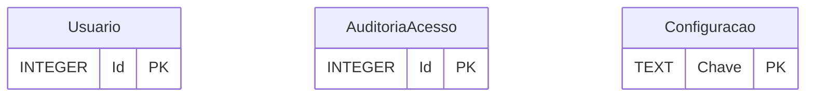
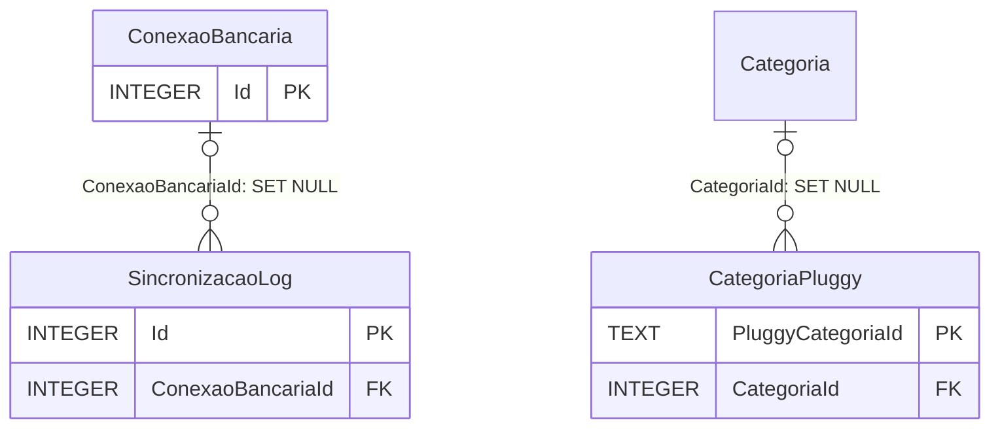
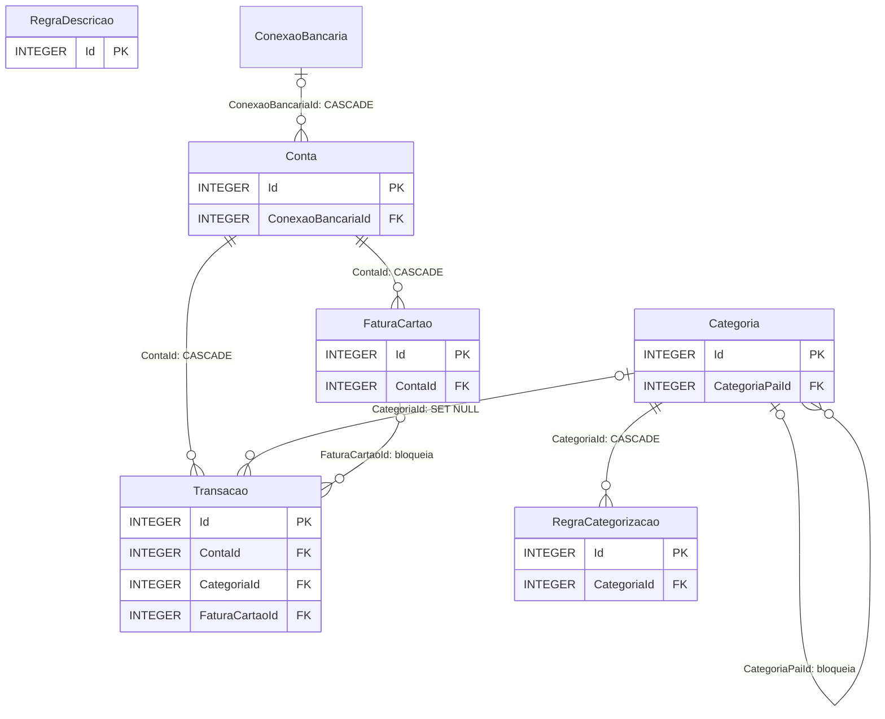
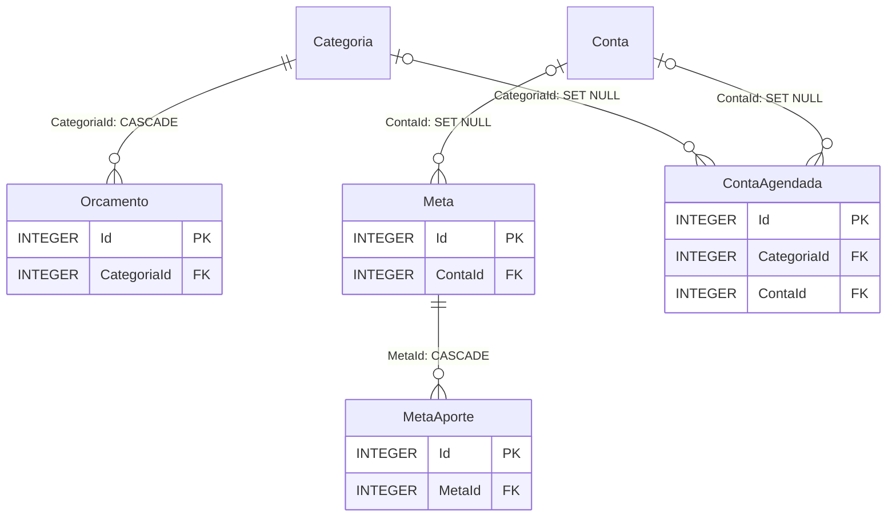
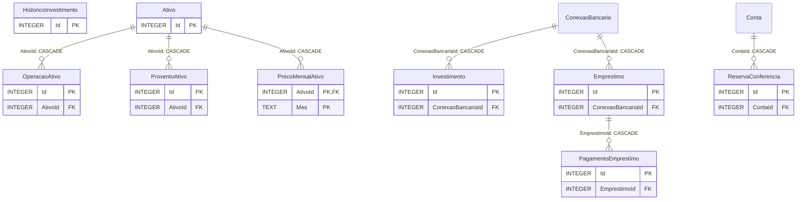
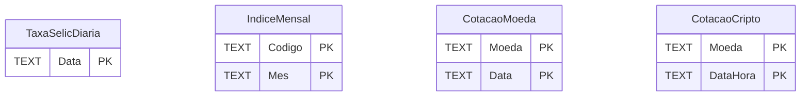
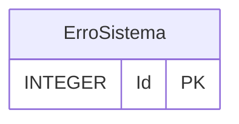

# Banco de dados

O banco é **SQLite**, num arquivo local (`dados/sql/FinancasLocal.db`), criado automaticamente na primeira conexão. O projeto **não usa migrations**: a estrutura completa vive em scripts SQL idempotentes, que podem ser executados quantas vezes for preciso:

| Arquivo | Conteúdo |
|---|---|
| `banco/01-estrutura.sql` | Tabelas, índices e restrições, todos com `CREATE TABLE/INDEX IF NOT EXISTS`. |
| `banco/02-dados-iniciais.sql` | Categorias padrão, configurações e regras de categorização iniciais. |

`scripts/geral/2-criar-banco.sh` executa os dois, em ordem, via `sqlite3`. A API também os aplica ao iniciar (`Data/EsquemaBanco.cs`, embutidos no build; os dados iniciais só no banco novo), com cópia em `dados/backups` antes de mudar um banco existente ([ADR 0003](adr/0003-esquema-por-scripts-sql-idempotentes.md)). Não há mais script de permissões: o acesso ao banco é a permissão de arquivo do sistema sobre `dados/`.

O `01-estrutura.sql` é uma baseline limpa da troca SQL Server → SQLite: as colunas que antes chegavam por `ALTER TABLE` incremental (blocos `v4`–`v7`) já nascem dentro do `CREATE TABLE`.

## O modelo em diagramas

Um diagrama por assunto, com as chaves primárias e estrangeiras. A seta diz a coluna e o que acontece ao apagar a linha referenciada: `CASCADE` apaga junto, `SET NULL` deixa a coluna vazia e `bloqueia` recusa. Tabela de outro assunto aparece sem colunas, só para mostrar a ligação.

O que o SQL não mostra:
- **Dinheiro em `TEXT`**, no formato do EF Core (`-5000.0`). Por isso, somar e comparar valores é feito no código, nunca no SQL.
- **Datas e horas em `TEXT`:** data de negócio no fuso de Brasília (`2026-10-15`); carimbo em UTC (`2026-10-15 22:55:31.3481471`).
- **GUID em maiúsculas**, e `bool` e `enum` em `INTEGER`.
- **Ligações sem chave estrangeira:** `Conta.ContaVinculadaId`, `Transacao.RegraDescricaoId`, `Transacao.PluggyCategoriaId` (para `CategoriaPluggy`), `CategoriaPluggy.PaiPluggyId`, `OperacaoAtivo.TransacaoId`, `HistoricoInvestimento.ConexaoBancariaId` e `HistoricoInvestimento.PluggyInvestmentId` (para `Investimento`, de propósito: o histórico do investimento resgatado fica) apontam para outra tabela, mas o banco não confere. Quem apaga a linha de cima cuida delas no código.

<!-- diagramas-do-banco: início (gerado por scripts/ci/gerar-diagrama-banco.py) -->

### Segurança



### Open Finance



### Financeiro



### Planejamento



### Investimentos



### Índices e cotações



### Sistema



<!-- diagramas-do-banco: fim -->

## Como alterar a estrutura

### Tabela nova

Adicione **no fim** de `01-estrutura.sql`, sempre com `IF NOT EXISTS`:

```sql
/* Assunto: descrição curta. */
CREATE TABLE IF NOT EXISTS NovaTabela
(
    Id      INTEGER NOT NULL CONSTRAINT PK_NovaTabela PRIMARY KEY AUTOINCREMENT,
    Nome    TEXT    NOT NULL
);

CREATE INDEX IF NOT EXISTS IX_NovaTabela_Nome ON NovaTabela (Nome);
```

### Coluna nova numa tabela existente

O SQLite não tem `ALTER TABLE ... ADD COLUMN IF NOT EXISTS`, então essa idempotência fica no script, não no SQL:

1. Inclua a coluna no `CREATE TABLE` de `01-estrutura.sql` (para quem cria o banco do zero), com a mesma definição do passo 2. Os testes do Go conferem as duas coisas (#367): `TestColunasNovasTambemNoCreateTable` falha se a coluna ficar só no `.sh`, e `TestBancoAntigoAtualizadoFicaIgualAoNovo`, se o banco novo e o antigo atualizado ficarem com tipo, `NOT NULL` ou padrão diferentes.
2. Em `scripts/geral/2-criar-banco.sh`, depois de aplicar o `01-estrutura.sql`, chame o helper de `comum.sh` (ele consulta `PRAGMA table_info` antes de alterar):

   ```bash
   adicionar_coluna_se_ausente "Tabela" "NovaColuna" "INTEGER NOT NULL DEFAULT 0"
   ```

   Coluna `NOT NULL` adicionada a uma tabela com dados precisa de `DEFAULT`.

   Mantenha esse formato (uma chamada por linha, os três argumentos entre aspas duplas): o instalador do Windows (`scripts/windows/instalar-windows.ps1`) e a própria API (`Data/EsquemaBanco.cs`, que embute o `2-criar-banco.sh` no build) leem essas linhas em vez de ter lista própria ([ADR 0012](adr/0012-instalador-do-windows-em-powershell.md), [ADR 0003](adr/0003-esquema-por-scripts-sql-idempotentes.md)).

### Depois de qualquer mudança

1. Atualize a entidade em `Entidades/` e o mapeamento em `Data/FinancasDbContext.cs` (tamanhos e precisão iguais ao SQL).
2. Rode `scripts/geral/2-criar-banco.sh` e depois `scripts/geral/3-publicar-atualizar.sh`.
3. Rode `python3 scripts/ci/verificar-sql.py` (o CI também aplica os scripts num banco descartável).
4. Em `src/backend-go`, rode `go generate ./...` e suba o que ele mudar: o back-end em Go leva uma cópia dos scripts dentro do executável e um esquema para o `sqlc` ([ADR 0049](adr/0049-back-end-em-go-trocado-aos-poucos-atras-do-dotnet.md)). O job Go da CI falha se a cópia ficar velha.
5. Tabela nova: entra em `ASSUNTOS` no `scripts/ci/gerar-diagrama-banco.py`. Rode `python3 scripts/ci/gerar-diagrama-banco.py` e suba os diagramas desta página (a CI confere com `--conferir`).
6. No commit, use `feat(banco)!:` para marcar que a estrutura mudou. Quem atualiza não precisa fazer nada: a API aplica o esquema ao iniciar ([ADR 0039](adr/0039-versao-sobe-a-cada-pr-pelo-tipo-do-commit.md)).

Regras:
- Nunca apague ou renomeie colunas em uso sem um bloco de transição.
- Nada de sintaxe do SQL Server (`GO`, `dbo.`, `[...]`, `IDENTITY`, `N'...'`, `OBJECT_ID`, `COL_LENGTH`): o `verificar-sql.py` recusa.
- Restrições e índices com nome explícito: `PK_`, `FK_`, `UQ_`, `CK_`, `DF_` (valor padrão), `IX_` (índice) e `UX_` (índice único, inclusive o parcial, com `WHERE`).
- Decimais e datas são gravados como `TEXT` (é como o provider SQLite do EF Core os guarda); a precisão vale pelo `HasPrecision` no `FinancasDbContext`.
- Chaves estrangeiras só valem com `PRAGMA foreign_keys = ON`, que o EF Core já envia em toda conexão — não desligue isso no provider, senão os `ON DELETE CASCADE/SET NULL` deixam de valer.
