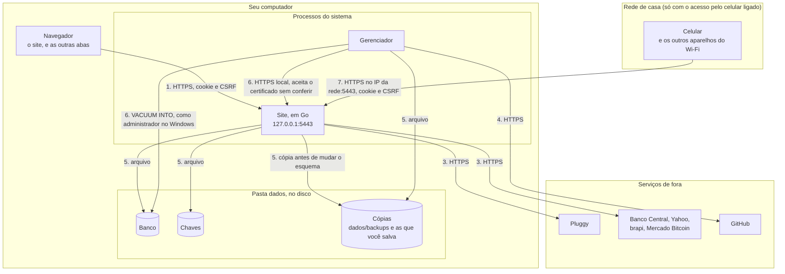

# Modelo de ameaças

De quem o sistema se protege, onde e como, e o que fica de fora. A proteção do dia a dia está em [SEGURANCA.md](SEGURANCA.md), os dados em [DADOS-PESSOAIS.md](DADOS-PESSOAIS.md), e a avaliação com a nota e o que melhorar na #68.

> **Data:** 09/11/2026, revisado no gerenciador que liga e desliga o acesso pelo celular (#684): duas rotas sem login nem CSRF, só para o próprio computador e com um segredo do gerenciador. Antes, no mesmo dia, no gerenciador que mostra o acesso (#679). Antes, 07/11/2026, no acesso pelo celular (#328, ADR 0061): a rede de casa vira uma fronteira, a 7, só com o acesso ligado. Antes, 03/11/2026, na remoção do .NET (#86): o site é um processo só, em Go, e a fronteira "API ↔ Go" deixou de existir. Revise este modelo quando mudar uma fronteira: uma saída de rede nova, um processo ou uma porta nova, a pasta `dados` ou o login.

## De quem o sistema se protege

O sistema escuta em `127.0.0.1`, então, com o acesso pelo celular desligado (o padrão), o risco real não vem da rede. Ele vem de:
- **outro processo ou outro usuário no mesmo computador**, como um malware rodando com a sua conta;
- **um site aberto no navegador**, que tenta falar com `127.0.0.1`;
- **quem pega o arquivo**: uma cópia do banco, um disco perdido;
- **com o acesso pelo celular ligado, quem está na rede de casa**: um convidado no Wi-Fi, um aparelho com falha, um roteador comprometido (fronteira 7).

## Fora do escopo

- **Quem já é administrador da máquina:** lê a memória, as chaves e o banco.
- **Disco sem criptografia:** a recomendação é ativar o BitLocker ou o LUKS.
- **Comprometimento da Pluggy ou do banco:** o sistema confia no que o Open Finance entrega.

## Fronteiras de confiança

Cada moldura é uma fronteira, e as setas que a cruzam são as analisadas abaixo.

## Ameaças por fronteira

[STRIDE](https://learn.microsoft.com/en-us/azure/security/develop/threat-modeling-tool-threats): falsificação de identidade, adulteração, repúdio, vazamento de informação, negação de serviço e aumento de privilégio. "—" na última coluna quer dizer que não há nada aberto.

### 1. Navegador ↔ API

| | Ameaça | Proteção que existe | O que falta |
|---|---|---|---|
| **Falsificação** | Outro processo tenta entrar como você | Senha com hash PBKDF2, bloqueio por tentativas (padrão de 5 erros e 15 min, ajustável em Parametrização) e limite por minuto (`internal/plataforma/autenticacao`), cookie `__Host-` `HttpOnly`, `Secure` e `SameSite=Strict` | Sair não invalida a sessão no servidor (#68, item 3). Política de senha (#68, item 8) |
| **Adulteração** | Um site aberto no navegador manda um pedido em seu nome (CSRF), ou aponta um domínio para `127.0.0.1` (DNS rebinding) | Token antifalsificação em todo pedido que grava e `AllowedHosts` restrito | — |
| **Repúdio** | Negar uma ação feita no site | `AuditoriaAcesso`: login, falhas, bloqueios, senha, parâmetros, credenciais, conexões, alterações em lote nas transações e conferências de investimentos, cada um com o desfazer | A auditoria fica no banco: quem tem o arquivo pode mudá-la |
| **Vazamento** | Script de terceiros, cache ou erro detalhado expõem dados | CSP sem script de terceiros, `no-store` na `/api` e erro genérico ([ADR 0034](adr/0034-sem-sri-no-build-do-front-end.md)) | Certificado confiável para a máquina inteira, com a senha em texto puro (#68, item 5) |
| **Negação de serviço** | Pedidos em excesso derrubam o site | Limite no login e corpo de até 1 MB (`servidor.LimiteDoCorpo`) | — |
| **Aumento de privilégio** | Alguém usa uma rota sem login | Tudo exige login, menos as rotas anônimas do login (`Autenticacao.Proteger`, na frente de toda a `/api`) | A configuração inicial fica aberta até alguém usá-la (#68, item 4) |

### 2. API ↔ Go (saiu na #86)

Até a #86, a API em .NET ficava na frente e repassava ao Go, num processo filho, as rotas já migradas, em HTTP local, com um segredo interno novo a cada partida e o usuário num cabeçalho. Com o .NET fora, o site é um processo só: não há porta interna, segredo interno nem repasse, e as ameaças desta fronteira deixaram de existir. O número fica, para as setas do diagrama não mudarem de nome.

### 3. Site ↔ serviços de fora

| | Ameaça | Proteção que existe | O que falta |
|---|---|---|---|
| **Falsificação** | Um servidor se passa pela Pluggy ou pela cotação | HTTPS, com host fixo no código. A URL da Pluggy é recusada se não for HTTPS | — |
| **Adulteração** | Resposta alterada no caminho | HTTPS. A resposta é lida em tipos, com validação | — |
| **Repúdio** | Não saber o que foi trazido | `SincronizacaoLog` | — |
| **Vazamento** | O destino fica sabendo mais do que deve | Só o mínimo, por HTTPS ([tabela](SEGURANCA.md#o-que-sai-para-a-internet)). O Client Secret só vai para a Pluggy | Os códigos dos ativos, com as datas, mostram a carteira ao Yahoo e à brapi (#68, complemento) |
| **Negação de serviço** | Um serviço de fora trava ou cai | Tempo limite em cada cliente, e a falha de cotação não para o resto | — |
| **Aumento de privilégio** | Texto de fora vira código | O Angular escapa o texto, não há `innerHTML`, e as consultas são parametrizadas | — |

### 4. Gerenciador ↔ GitHub

| | Ameaça | Proteção que existe | O que falta |
|---|---|---|---|
| **Falsificação** | Outro servidor oferece um `.msi` | HTTPS, com o repositório fixo no código | — |
| **Adulteração** | `.msi` trocado no caminho | O SHA256 tem de bater com o publicado junto ([ADR 0028](adr/0028-gerenciador-do-windows-e-atualizacao-pelo-github.md)) | O `.msi` não é assinado: o hash vem do mesmo lugar que o arquivo |
| **Repúdio** | Não saber o que foi instalado | O log do instalador ([OPERACAO.md](OPERACAO.md#atualização-que-falhou)) | — |
| **Vazamento** | O gerenciador envia dados seus | Só lê o release público, sem enviar nada seu | — |
| **Negação de serviço** | O download falha | Nada é instalado, e a versão atual continua | — |
| **Aumento de privilégio** | Um release comprometido roda como administrador | O `.msi` pede o UAC, e a CI gera o pacote | Actions sem pin e a cadeia de dependências (#68, item 7) |

### 5. A pasta `dados`, no disco

Fica em `C:\ProgramData\FinancasLocal\dados` na instalação pelo `.msi`, e na pasta `dados` do projeto na instalação pelos scripts (Windows ou Linux). A proteção muda com o jeito de instalar, como a tabela diz.

| | Ameaça | Proteção que existe | O que falta |
|---|---|---|---|
| **Falsificação** | Outro usuário usa os arquivos | Sem senha de banco: vale a permissão do sistema. No `.msi`, só o sistema e os administradores; pelos scripts no Linux, só a sua conta (`chmod 700`); pelos scripts no Windows, a permissão que a pasta do projeto já tinha | — |
| **Adulteração** | Um usuário sem privilégio troca os arquivos do serviço | No `.msi`, as pastas são protegidas | O serviço como SYSTEM a partir de pastas alteráveis, na instalação pelos scripts (#68, item 1) |
| **Repúdio** | Apagar o rastro no banco | — | A auditoria não tem cópia fora do banco |
| **Vazamento** | Alguém copia o banco ou uma cópia | Segredos cifrados com AES-256-GCM (`internal/plataforma/segredos`), com a chave em `dados/chaves/segredos.chave`, protegida pelo DPAPI no Windows e pela permissão do arquivo no Linux. As cópias automáticas (as 5 mais recentes, antes de mudar o esquema, `AplicarEsquema`) ficam em `dados/backups`, com a permissão da pasta; as outras, só onde você escolhe | Banco e cópias sem criptografia (#68, item 2) |
| **Negação de serviço** | O banco corrompe ou some | Cópia antes de mudar a estrutura, e o [guia de restaurar](OPERACAO.md#restaurar-uma-cópia) | — |
| **Aumento de privilégio** | O serviço é usado para rodar outra coisa | No Linux, roda na conta do usuário | O serviço do Linux sem isolamento (#68, item 6) |

### 6. Gerenciador ↔ API e banco

O gerenciador roda na sua conta, fora da API. Ele pergunta à API se o site responde (`GET /api/auth/estado`) e se o acesso pelo celular está ligado (`GET /api/celular/estado`, #679; só lê, e o site só responde ao próprio computador). Ele também liga e desliga esse acesso (#684): lê o segredo `dados/chaves/gerenciador-celular.chave` e chama `POST /api/celular/gerenciador/ligar` ou `desligar`, que o site só aceita do próprio computador e com o segredo. Ele copia o banco com `VACUUM INTO`. Ele também restaura uma cópia escolhida por você (#533): confere o arquivo, desliga o site, guarda o banco de agora em `dados/antes-de-restaurar`, troca e liga. No Windows, copiar, restaurar, ligar e desligar rodam numa instância dele elevada pelo UAC (`--backup`, `--restaurar`, `--servico`, `--celular`), porque a pasta de dados só abre para o sistema e os administradores.

| | Ameaça | Proteção que existe | O que falta |
|---|---|---|---|
| **Falsificação** | Outro processo ocupa a porta do site e se passa pela API para o gerenciador | A consulta não manda nada seu e só muda a situação mostrada ("no ar", "não responde") | O gerenciador aceita qualquer certificado quando o endereço é de loopback (`situacao.go`, `InsecureSkipVerify`), para funcionar antes de o sistema confiar no certificado. Conferir o certificado da instalação, pela impressão digital, fecharia isso (*julgamento*) |
| **Adulteração** | Um destino escolhido sobrescreve um arquivo importante | O destino vem da janela de salvar, escolhido por você | No Windows, a gravação roda como administrador: o destino pode ser uma pasta que a sua conta não escreveria |
| **Adulteração** | Um banco montado por outra pessoa entra no lugar do seu pela restauração (#533) | O arquivo vem da janela de abrir, escolhido por você, depois da pergunta que diz o que muda; o gerenciador confere que é um banco do site, e o de antes fica em `dados/antes-de-restaurar` | A conferência vê a estrutura, não a origem: um banco do site adulterado passa (*julgamento*: é o mesmo risco de restaurar à mão) |
| **Repúdio** | Não saber quem copiou ou restaurou o banco | — | A cópia e a restauração pelo gerenciador não entram na auditoria do site (a restauração troca a própria auditoria pela da cópia) |
| **Vazamento** | A cópia vai para um lugar inseguro | O gerenciador avisa que a cópia tem todos os seus dados | A cópia sai sem criptografia (#68, item 2) |
| **Negação de serviço** | A cópia trava o site | `VACUUM INTO` lê numa transação, com o banco em WAL, e o site continua no ar | — |
| **Aumento de privilégio** | Outro programa usa a instância elevada do gerenciador | A instância elevada só aceita as ações fixas (`--backup <destino>`, `--restaurar <cópia>`, `--servico ligar\|desligar\|reiniciar` e, só na instalação de desenvolvimento, `--instalar-pelos-scripts`) e pede o UAC a cada vez | Quem aprova o UAC não vê o arquivo da `--restaurar`: um programa que já roda na sua conta pode pedir a restauração de um arquivo dele, e o aviso do Windows mostra só o gerenciador (*julgamento*: o mesmo vale para o destino da `--backup`) |

### 7. Celular ↔ site, pela rede de casa (#328)

Só existe com o acesso pelo celular ligado (Configurações › Segurança, [ADR 0061](adr/0061-acesso-pelo-celular-na-rede-local.md)). O site abre um segundo servidor no IP escolhido (um IPv4 privado deste computador), com o mesmo login, CSRF e cabeçalhos do servidor de `127.0.0.1`.

| | Ameaça | Proteção que existe | O que falta |
|---|---|---|---|
| **Falsificação** | Alguém no Wi-Fi tenta adivinhar a senha | O mesmo login da fronteira 1: bloqueio por tentativas e limite de 5 por minuto **por IP** (cada aparelho tem o seu) | A senha passa a ser a barreira: sem política de senha (#68, item 8), uma senha fraca é risco real. A tela de ligar avisa |
| **Falsificação** | Um aparelho da rede se passa pelo site para o celular (homem no meio), para pegar a senha | HTTPS com o certificado de uma autoridade local que o celular instalou; a tela mostra a impressão digital para conferir | Na primeira vez, o celular baixa a autoridade por uma conexão em que ainda não confia: quem estiver no meio nesse momento pode trocar o arquivo. Conferir a impressão digital fecha isso, mas depende da pessoa (*julgamento*) |
| **Adulteração** | Um site de fora aponta um domínio para o IP da rede (DNS rebinding) | O servidor da rede só aceita o próprio IP no `Host` | — |
| **Repúdio** | Não saber qual aparelho entrou ou ligou o acesso | A auditoria grava o IP de cada login e o ligar e desligar | — |
| **Vazamento** | Roubar a chave da autoridade para assinar outros sites em que o celular confia | A chave fica em `dados/chaves`, com a proteção das outras chaves, e a autoridade tem restrição de nomes: só IPs de rede de casa, nenhum nome de site | Com a chave, dá para se passar por outro IP da rede de casa (o roteador) para o celular. A restrição não foi conferida num celular de verdade (*não validado com uso real*) |
| **Vazamento** | A porta aberta num Wi-Fi público (café, aeroporto) | No Windows, a regra do firewall vale só no perfil Particular e só para a sub-rede local; a tela avisa quando a rede está como Pública | No Linux, o site não mexe no firewall: sem `ufw` nem `firewalld` ligados, a porta fica aberta em qualquer rede em que o IP escolhido estiver |
| **Negação de serviço** | Um aparelho da rede enche o site de pedidos | Os mesmos limites da fronteira 1 (login e corpo) | Sem limite de pedidos fora do login (*julgamento*: o mesmo risco de antes, agora com a rede de casa) |
| **Aumento de privilégio** | Alguém usa uma rota sem login pela rede | Tudo exige login, menos as rotas novas: a da autoridade (`GET /api/celular/autoridade`), que entrega só o certificado público; a do estado para o gerenciador (`GET /api/celular/estado`, #679), que só responde a quem pede do próprio computador (pela rede, 404) e só diz ligado e o endereço; e as de ligar e desligar do gerenciador (#684), que, além do próprio computador, exigem o segredo da pasta das chaves (sem ele, 404) | A conferência é pelo endereço de quem conectou: vale porque o site é servido direto, sem proxy na frente. Um proxy local no futuro faria todo pedido parecer do próprio computador (*julgamento*: os testes estão em `celular/rotas_test.go` e `celular/gerenciador_test.go`) |
| **Aumento de privilégio** | Um programa do computador liga a porta da rede sem a pessoa saber (#684) | As rotas do gerenciador pedem o segredo, que no Windows só administradores leem (o gerenciador pede o UAC); sem CSRF, mas com um cabeçalho próprio que um site de fora não consegue mandar. Ligado, entrar pelo celular ainda exige a senha | No Linux, qualquer programa da sessão do usuário lê o segredo (é a mesma conta do serviço). O gerenciador aceita o certificado do site sem conferir no loopback: um programa que tomasse a porta 5443 com o site parado receberia o segredo, e com ele só liga e desliga o acesso (*julgamento*: risco baixo, porque o botão só aparece com o site no ar) |

## Ligação com a #68

| Item da #68 | Onde está aqui |
|---|---|
| 1. Serviço como SYSTEM a partir de pastas alteráveis | Fronteira 5, adulteração |
| 2. Banco e cópias sem criptografia | Fronteira 5, vazamento |
| 3. Sair não invalida a sessão no servidor | Fronteira 1, falsificação |
| 4. Configuração inicial aberta | Fronteira 1, aumento de privilégio |
| 5. Certificado confiável para a máquina inteira | Fronteira 1, vazamento |
| 6. Serviço do Linux sem isolamento | Fronteira 5, aumento de privilégio |
| 7. CI e cadeia de dependências | Fronteira 4, aumento de privilégio |
| 8. Política de senha e bloqueio | Fronteira 1, falsificação |
| 9. Sobras da instalação antiga com IIS | Fora daqui: não muda uma fronteira |
