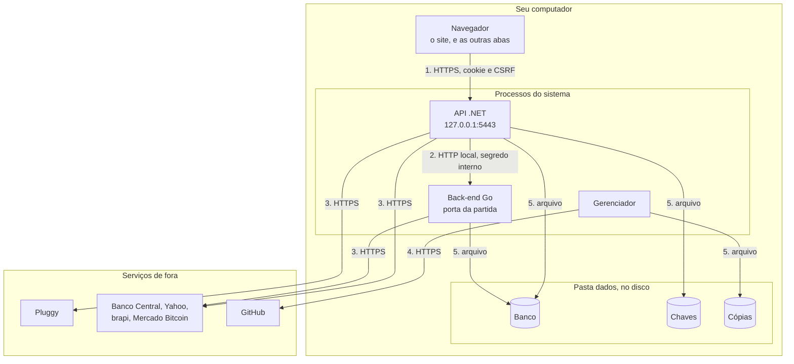

# Modelo de ameaças

De quem o sistema se protege, onde e como, e o que fica de fora. A proteção do dia a dia está em [SEGURANCA.md](SEGURANCA.md), os dados em [DADOS-PESSOAIS.md](DADOS-PESSOAIS.md), e a avaliação com a nota e o que melhorar na #68.

> **Data:** 31/10/2026, na fase "Go atrás do .NET" (#231). Revise este modelo quando mudar uma fronteira: uma saída de rede nova, um processo ou uma porta nova, a pasta `dados`, o login e a remoção do .NET (#86).

## De quem o sistema se protege

O sistema só escuta em `127.0.0.1`, então o risco real não vem da rede. Ele vem de:
- **outro processo ou outro usuário no mesmo computador**, como um malware rodando com a sua conta;
- **um site aberto no navegador**, que tenta falar com `127.0.0.1`;
- **quem pega o arquivo**: uma cópia do banco, um disco perdido.

## Fora do escopo

- **Quem já é administrador da máquina:** lê a memória, as chaves e o banco.
- **Disco sem criptografia:** a recomendação é ativar o BitLocker ou o LUKS.
- **Comprometimento da Pluggy ou do banco:** o sistema confia no que o Open Finance entrega.

## Fronteiras de confiança

Cada moldura é uma fronteira, e as setas que a cruzam são as analisadas abaixo.

## Ameaças por fronteira

[STRIDE](https://learn.microsoft.com/en-us/azure/security/develop/threat-modeling-tool-threats): falsificação de identidade, adulteração, repúdio, vazamento de informação, negação de serviço e aumento de privilégio. "—" na última coluna quer dizer que não há nada aberto.

### 1. Navegador ↔ API

| | Ameaça | Proteção que existe | O que falta |
|---|---|---|---|
| **Falsificação** | Outro processo tenta entrar como você | Senha com hash PBKDF2, bloqueio por tentativas (padrão de 5 erros e 15 min, ajustável em Parametrização) e limite por minuto (`AuthController`), cookie `__Host-` `HttpOnly`, `Secure` e `SameSite=Strict` | Sair não invalida a sessão no servidor (#68, item 3). Política de senha (#68, item 8) |
| **Adulteração** | Um site aberto no navegador manda um pedido em seu nome (CSRF), ou aponta um domínio para `127.0.0.1` (DNS rebinding) | Token antifalsificação em todo pedido que grava e `AllowedHosts` restrito | — |
| **Repúdio** | Negar uma ação feita no site | `AuditoriaAcesso`: login, falhas, bloqueios, senha, parâmetros, credenciais, conexões, alterações em lote nas transações e conferências de investimentos, cada um com o desfazer | A auditoria fica no banco: quem tem o arquivo pode mudá-la |
| **Vazamento** | Script de terceiros, cache ou erro detalhado expõem dados | CSP sem script de terceiros, `no-store` na `/api` e erro genérico ([ADR 0034](adr/0034-sem-sri-no-build-do-front-end.md)) | Certificado confiável para a máquina inteira, com a senha em texto puro (#68, item 5) |
| **Negação de serviço** | Pedidos em excesso derrubam o site | Limite no login e corpo de até 1 MB (`Program.cs`) | — |
| **Aumento de privilégio** | Alguém usa uma rota sem login | Tudo exige login por padrão (`FallbackPolicy`) | A configuração inicial fica aberta até alguém usá-la (#68, item 4) |

### 2. API ↔ Go

| | Ameaça | Proteção que existe | O que falta |
|---|---|---|---|
| **Falsificação** | Outro processo fala direto com o Go | Segredo interno novo a cada partida, passado pela entrada padrão, e comparado em tempo constante (`atras_do_dotnet.go`). Sem ele: 401 | Revisar na inversão (#85) |
| **Adulteração** | Pedido de fora traz `X-Financas-Usuario` | O repasse apaga todo `X-Financas-*` que vem de fora (`RepasseGo.cs`) | — |
| **Repúdio** | Não saber quem fez uma ação no Go | O Go grava a auditoria com o usuário que a API informa | — |
| **Vazamento** | Sessão ou token chegam ao Go, em HTTP local | O repasse tira o cookie e o token CSRF. A conversa não sai de `127.0.0.1` | Revisar na inversão (#85) |
| **Negação de serviço** | O Go cai | As rotas dele respondem 503, e a API o reinicia, esperando mais a cada vez (`ProcessoGo.cs`) | — |
| **Aumento de privilégio** | O Go aceita um usuário sem login | A API só repassa com sessão válida e CSRF conferido, e o Go só aceita com o segredo | — |

### 3. API e Go ↔ serviços de fora

| | Ameaça | Proteção que existe | O que falta |
|---|---|---|---|
| **Falsificação** | Um servidor se passa pela Pluggy ou pela cotação | HTTPS, com host fixo no código. A URL da Pluggy é recusada se não for HTTPS | — |
| **Adulteração** | Resposta alterada no caminho | HTTPS. A resposta é lida em tipos, com validação | — |
| **Repúdio** | Não saber o que foi trazido | `SincronizacaoLog` | — |
| **Vazamento** | O destino fica sabendo mais do que deve | Só o mínimo, por HTTPS ([tabela](SEGURANCA.md#o-que-sai-para-a-internet)). O Client Secret só vai para a Pluggy | Os códigos dos ativos, com as datas, mostram a carteira ao Yahoo e à brapi (#68, complemento) |
| **Negação de serviço** | Um serviço de fora trava ou cai | Tempo limite em cada cliente, e a falha de cotação não para o resto | — |
| **Aumento de privilégio** | Texto de fora vira código | O Angular escapa o texto, não há `innerHTML`, e as consultas são parametrizadas | — |

### 4. Gerenciador ↔ GitHub

| | Ameaça | Proteção que existe | O que falta |
|---|---|---|---|
| **Falsificação** | Outro servidor oferece um `.msi` | HTTPS, com o repositório fixo no código | — |
| **Adulteração** | `.msi` trocado no caminho | O SHA256 tem de bater com o publicado junto ([ADR 0028](adr/0028-gerenciador-do-windows-e-atualizacao-pelo-github.md)) | O `.msi` não é assinado: o hash vem do mesmo lugar que o arquivo |
| **Repúdio** | Não saber o que foi instalado | O log do instalador ([OPERACAO.md](OPERACAO.md#atualização-que-falhou)) | — |
| **Vazamento** | O gerenciador envia dados seus | Só lê o release público, sem enviar nada seu | — |
| **Negação de serviço** | O download falha | Nada é instalado, e a versão atual continua | — |
| **Aumento de privilégio** | Um release comprometido roda como administrador | O `.msi` pede o UAC, e a CI gera o pacote | Actions sem pin e a cadeia de dependências (#68, item 7) |

### 5. A pasta `dados`, no disco

Fica em `C:\ProgramData\FinancasLocal\dados` na instalação pelo `.msi`, e na pasta `dados` do projeto na instalação pelos scripts (Windows ou Linux). A proteção muda com o jeito de instalar, como a tabela diz.

| | Ameaça | Proteção que existe | O que falta |
|---|---|---|---|
| **Falsificação** | Outro usuário usa os arquivos | Sem senha de banco: vale a permissão do sistema. No `.msi`, só o sistema e os administradores; pelos scripts no Linux, só a sua conta (`chmod 700`); pelos scripts no Windows, a permissão que a pasta do projeto já tinha | — |
| **Adulteração** | Um usuário sem privilégio troca os arquivos do serviço | No `.msi`, as pastas são protegidas | O serviço como SYSTEM a partir de pastas alteráveis, na instalação pelos scripts (#68, item 1) |
| **Repúdio** | Apagar o rastro no banco | — | A auditoria não tem cópia fora do banco |
| **Vazamento** | Alguém copia o banco ou uma cópia | Segredos cifrados com Data Protection, com chaves protegidas por DPAPI no Windows. Cópia só onde você escolhe | Banco e cópias sem criptografia (#68, item 2) |
| **Negação de serviço** | O banco corrompe ou some | Cópia antes de mudar a estrutura, e o [guia de restaurar](OPERACAO.md#restaurar-uma-cópia) | — |
| **Aumento de privilégio** | O serviço é usado para rodar outra coisa | No Linux, roda na conta do usuário | O serviço do Linux sem isolamento (#68, item 6) |

## Ligação com a #68

| Item da #68 | Onde está aqui |
|---|---|
| 1. Serviço como SYSTEM a partir de pastas alteráveis | Fronteira 5, adulteração |
| 2. Banco e cópias sem criptografia | Fronteira 5, vazamento |
| 3. Sair não invalida a sessão no servidor | Fronteira 1, falsificação |
| 4. Configuração inicial aberta | Fronteira 1, aumento de privilégio |
| 5. Certificado confiável para a máquina inteira | Fronteira 1, vazamento |
| 6. Serviço do Linux sem isolamento | Fronteira 5, aumento de privilégio |
| 7. CI e cadeia de dependências | Fronteira 4, aumento de privilégio |
| 8. Política de senha e bloqueio | Fronteira 1, falsificação |
| 9. Sobras da instalação antiga com IIS | Fora daqui: não muda uma fronteira |
