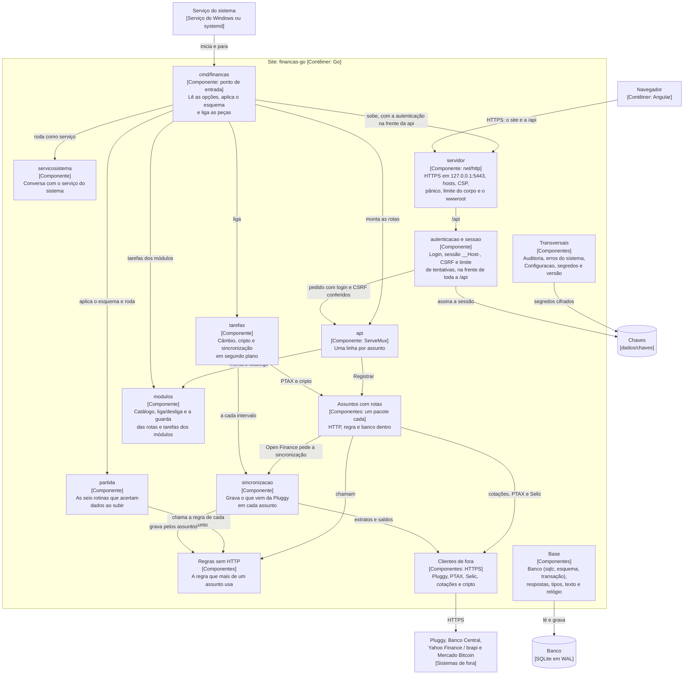
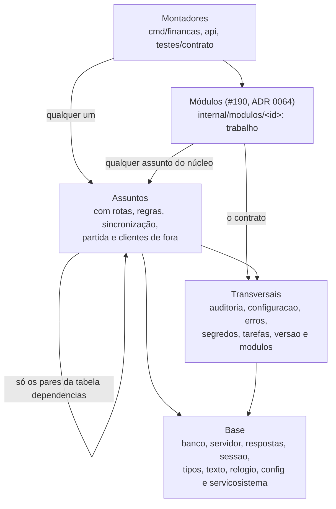

# Componentes do site em Go

Os pacotes do back-end, quem chama quem e onde fica a regra de cada assunto (nível 3 do [modelo C4](https://c4model.com/), só do Go). É o zoom do **Site** do [diagrama de Contêineres](../ARQUITETURA.md#contêineres). O padrão dos diagramas está na [ADR 0055](../adr/0055-documentacao-de-arquitetura-em-diagramas-mermaid.md), e as camadas, na [ADR 0056](../adr/0056-arquitetura-do-codigo-go-camadas-por-assunto-e-ddd-estrategico.md).

> **Data dos diagramas:** 04/11/2026, com o .NET já fora (#86). Pacote novo em `src/backend/internal/` entra na [tabela](#cada-pacote-num-componente) no mesmo PR; o teste de arquitetura local confere (`go test -tags arquitetura ./internal/arquitetura/`).

## Componentes

Os 61 pacotes cabem em 13 caixas. O que cada caixa tem, pacote por pacote, está na [tabela](#cada-pacote-num-componente) logo abaixo.

- **Setas que não estão no desenho:** todos os componentes usam a base e os transversais. Desenhar uma seta de cada um deixaria o diagrama ilegível.
- **Quem liga as peças é o `cmd/financas`.** Ele chama o `api.Montar`, põe o `autenticacao.Proteger` na frente das rotas, registra as rotas dos erros do sistema e da autenticação e passa tudo ao `servidor.Rodar`. Não há container de injeção: cada `Servico` recebe o que usa no construtor (ADR 0056).
- **A sincronização é uma instância só.** A rota do Open Finance e a tarefa agendada usam a mesma, por causa da trava de uma rodada por vez (`api.Montado.Sincronizacao`).
- **O caminho de um pedido** pelas caixas está no fluxo [Um pedido à API](fluxos.md#um-pedido-à-api).

## Cada pacote num componente

Os pacotes de `src/backend`, cada um em um componente só. O componente é o papel do pacote; a pasta (`internal/<area>/<assunto>`) segue a tela, e as áreas estão no [`internal/README.md`](../../src/backend/internal/README.md#as-áreas). A coluna **Grupo no teste** diz em qual lista do teste de arquitetura (`internal/arquitetura/arquitetura_test.go`) o pacote está, e é ela que decide o que ele pode importar.

| Componente | Pacotes | O que fazem | Grupo no teste |
|---|---|---|---|
| Ponto de entrada | `cmd/financas` | As opções (`-aplicar-esquema`, `-rotinas-de-partida`), a ligação das peças e o subcomando `gerar-certificado`. | montador |
| Serviço do sistema | `internal/plataforma/servicosistema` | Roda como Serviço do Windows ou systemd e para com o sinal. | base |
| Servidor | `internal/plataforma/servidor` | HTTPS local, filtro de hosts, cabeçalhos de segurança (a CSP), pânico, limite de 1 MB no corpo, os arquivos do site e o certificado. | base |
| Autenticação | `internal/plataforma/autenticacao`, `internal/plataforma/sessao` | Login, sessão, CSRF e limite de tentativas (#75); o `sessao` guarda o usuário logado no contexto do pedido. | assunto (`autenticacao`), base (`sessao`) |
| Acesso pelo celular | `internal/plataforma/celular` | O segundo servidor no IP da rede de casa, a autoridade local que assina o certificado do celular e a regra do firewall (#328, ADR 0061). O `cmd/financas` o monta com o pipeline do site, e as rotas ficam em Configurações › Segurança. | assunto |
| Rotas | `internal/api` | O `ServeMux` com as rotas de todos os assuntos, numa linha cada. | montador |
| Assuntos com rotas | `internal/plataforma/saude`, `internal/ajustes/parametros`, `internal/patrimonio/cambio`, `internal/patrimonio/cripto`, `internal/ajustes/categorias`, `internal/movimentacao/contas`, `internal/movimentacao/extrato`, `internal/movimentacao/contasagendadas`, `internal/planejamento/orcamentos`, `internal/patrimonio/reservas`, `internal/planejamento/metas`, `internal/patrimonio/carteira`, `internal/movimentacao/conferenciabanco`, `internal/analises/painel`, `internal/patrimonio/investimentos`, `internal/openfinance/openfinance` | Cada um põe as rotas dele no mux (`Registrar`) e tem a regra da própria tela. O `cambio` e o `cripto` também têm o cliente da PTAX e o do Mercado Bitcoin e a tarefa de cada um. | assunto |
| Regras sem HTTP | `internal/movimentacao/transacoes`, `internal/ajustes/categorizacao`, `internal/ajustes/regrasdescricao`, `internal/movimentacao/transferencias`, `internal/movimentacao/tipolancamento`, `internal/movimentacao/sugestoes`, `internal/movimentacao/poucoinformativa`, `internal/plataforma/desfazer`, `internal/movimentacao/parcelas`, `internal/movimentacao/faturas`, `internal/movimentacao/bancos`, `internal/movimentacao/cobrancas`, `internal/analises/relatorios`, `internal/patrimonio/emprestimos` | A regra que mais de um assunto usa, sem nada de HTTP. O `transferencias` ainda chega ao HTTP pelo `reservas` (exceção registrada no teste). | assunto |
| Sincronização | `internal/openfinance/sincronizacao` | A rodada com a Pluggy (#83): grava contas, transações, investimentos e empréstimos e, no fim, roda as mesmas rotinas da partida. | assunto |
| Partida | `internal/partida` | As seis rotinas que acertam dados ao subir (#444). Só chama a regra de cada assunto. | assunto |
| Tarefas | `internal/plataforma/tarefas` | O laço periódico das tarefas em segundo plano, que segue no próximo ciclo depois de um erro ou de um pânico. | transversal |
| Núcleo dos módulos | `internal/plataforma/modulos` | O contrato que cada módulo implementa, o catálogo com o liga/desliga (na `Configuracao`), as rotas `/api/modulos`, a guarda das rotas de cada módulo (desligado, 409) e as tarefas dele, que só rodam com ele ligado (#191, ADR 0064). | transversal |
| Módulo Trabalho | `internal/modulos/trabalho`, `internal/modulos/trabalho/emprego`, `internal/modulos/trabalho/encargos`, `internal/modulos/trabalho/holerite`, `internal/modulos/trabalho/decimoterceiro`, `internal/modulos/trabalho/ferias`, `internal/modulos/trabalho/fgts`, `internal/modulos/trabalho/recebimento`, `internal/modulos/trabalho/rescisao` | O primeiro módulo (#209, ADR 0065): o `trabalho` implementa o contrato e junta as rotas; o `emprego` guarda o emprego e o salário com vigência e estima o mês; o `holerite` calcula, guarda e congela o holerite de cada mês (#211); o `decimoterceiro` calcula o 13º pelos avos e pela média dos holerites (#214); o `ferias` monta os períodos, agenda as frações pelas regras da CLT e calcula cada uma (#213); o `fgts` estima o saldo mês a mês e guarda as conferências e os saques (#216, ADR 0066); o `recebimento` liga o crédito do salário (a transação) ao holerite, sem somar nada nos relatórios (#212; usa o `tipolancamento` do núcleo); o `rescisao` simula os cinco tipos de desligamento com o FGTS e registra a rescisão real (#215); o `encargos` calcula o INSS e o IRRF pelas tabelas da vigência, sem HTTP. Rotas em `/api/trabalho/`. | módulo |
| Clientes de fora | `internal/openfinance/pluggy`, `internal/patrimonio/cotacoes`, `internal/patrimonio/selic` | HTTPS para a Pluggy (ADR 0006), o Yahoo Finance e a brapi, e a Selic do Banco Central. A PTAX e o Mercado Bitcoin moram no `cambio` e no `cripto`. | assunto |
| Transversais | `internal/plataforma/auditoria`, `internal/plataforma/configuracao`, `internal/plataforma/erros`, `internal/plataforma/segredos`, `internal/plataforma/versao` | Auditoria, a tabela `Configuracao`, os erros do sistema (ADR 0022, com as rotas de Configurações › Erros), os segredos cifrados e a versão. | transversal |
| Base | `internal/plataforma/banco`, `internal/plataforma/banco/consultas`, `internal/plataforma/banco/esquema`, `internal/plataforma/banco/esquema/embutido`, `internal/plataforma/config`, `internal/plataforma/relogio`, `internal/plataforma/respostas`, `internal/plataforma/texto`, `internal/plataforma/tipos` | O SQLite em WAL, a transação, as consultas do `sqlc`, o esquema ao iniciar com a cópia embutida dos scripts, os appsettings, o fuso de Brasília, as respostas HTTP de sempre e os tipos no formato do banco. | base |
| Só para teste e geração | `internal/arquitetura`, `internal/plataforma/testeapoio`, `internal/plataforma/banco/esquema/gerar`, `testes/contrato`, `testes/contrato/pluggyfalsa` | O teste de arquitetura, o apoio aos testes, o `go generate` da cópia embutida e os casos de contrato com a Pluggy falsa. Nada disso entra no executável. | montador ou base |

### Onde fica a regra de cada assunto

Cada assunto com rotas tem a própria regra no pacote dele. Quando a regra serve a mais de um, ela vai para um pacote de regra (ADR 0056). Os pares abaixo vêm da tabela `dependencias` do teste, que tem o motivo de cada um.

| Assunto (a tela) | Usa a regra de |
|---|---|
| `extrato` (Transações) | `transacoes`, `categorizacao`, `regrasdescricao`, `transferencias`, `tipolancamento`, `sugestoes`, `poucoinformativa`, `desfazer` |
| `categorias` (Categorias e regras) | `categorizacao`, `regrasdescricao`, `transferencias`, `transacoes` |
| `contas` (Contas e faturas) | `bancos`, `faturas` |
| `contasagendadas` (Contas a pagar) | `cobrancas`, `relatorios`, `sugestoes`, `categorizacao`, `transacoes` |
| `orcamentos` | `relatorios`, `emprestimos`, `parametros`, `transacoes` |
| `metas` | `relatorios`, `faturas`, `parcelas`, `transacoes`, e os assuntos `contas`, `reservas` e `parametros` |
| `painel` (Painel e relatórios) | `relatorios`, `emprestimos`, `faturas`, `poucoinformativa`, `transacoes`, e o resumo de `contas`, `carteira`, `contasagendadas`, `extrato`, `reservas` e `cambio` |
| `carteira` (Investimentos) | `cotacoes`, `selic`, `cambio`, `reservas`, `bancos`, `contas`, `categorizacao`, `desfazer`, `transacoes` |
| `investimentos` (os do Open Finance) | `carteira`, `cambio` |
| `conferenciabanco` (Conferir com o banco) | `contas`, `faturas`, `carteira`, `reservas`, `bancos`, `cambio` |
| `openfinance` (Conexões) | `sincronizacao`, `pluggy`, `contas`, `cotacoes`, `categorizacao`, `transferencias`, `transacoes` |
| `reservas`, `cambio`, `cripto`, `parametros`, `saude` | só a própria, a base e os transversais (`reservas` usa o `cambio`) |

## Regras de dependência

Quem pode importar quem. As setas vão de quem importa para quem é importado.

O teste de arquitetura confere cinco regras:

1. **Só o `internal/plataforma/banco` abre o SQLite.** O driver (`modernc.org/sqlite`) só pode ser importado por ele, pelo `internal/plataforma/banco/esquema` e pelo contrato. Os outros recebem o `*sql.DB` já aberto, em WAL e com o `busy_timeout`.
2. **O `internal/plataforma/testeapoio` só nos `_test.go`.** O executável não leva o banco vazio de teste nem as fábricas de dados.
3. **A regra não conhece HTTP.** Os pacotes da lista `regraSemHTTP` (as regras sem HTTP e a base sem HTTP) não chegam a `net/http`, `internal/plataforma/respostas` nem `internal/plataforma/servidor`, nem por outro pacote. Há duas exceções registradas: o `transferencias` (pelo `reservas.EhMovimentoDeReserva`) e o `tarefas` (pelos erros do sistema).
4. **Um assunto importa outro só pelo mapa de contextos.** A regra *não* é "um assunto não importa outro": muitos importam, como o `painel`, que junta o resumo de cada tela. Mas cada par tem de estar na tabela `dependencias`, com o motivo. Base e transversais não importam assunto. Pacote fora de todos os grupos faz o teste falhar.
5. **Módulos à parte.** Todo pacote da pasta internal/modulos é de módulo, sem lista: `internal/modulos/<id>` e os assuntos dele (`internal/modulos/<id>/<assunto>`), que se importam à vontade. O núcleo (inclusive o `internal/plataforma/modulos`) não importa módulo, e um módulo não importa outro (ADR 0064).

**Conferido em 04/11/2026:** `go test -count=1 -tags arquitetura ./internal/arquitetura/` passou, com as cinco regras e as duas exceções acima. O mesmo teste confere se cada pacote aparece na [tabela](#cada-pacote-num-componente) desta página.
