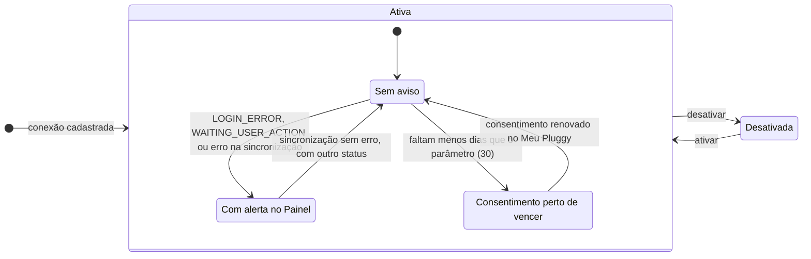
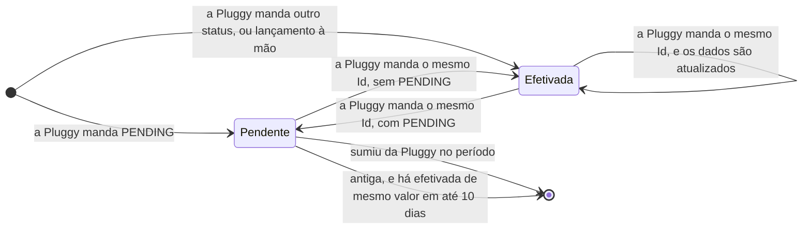
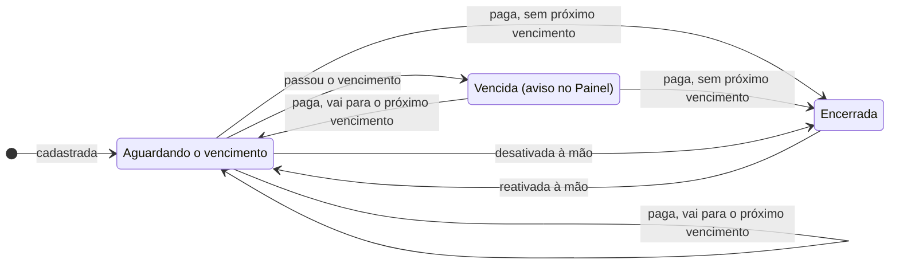
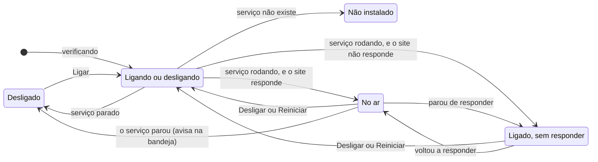
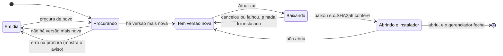
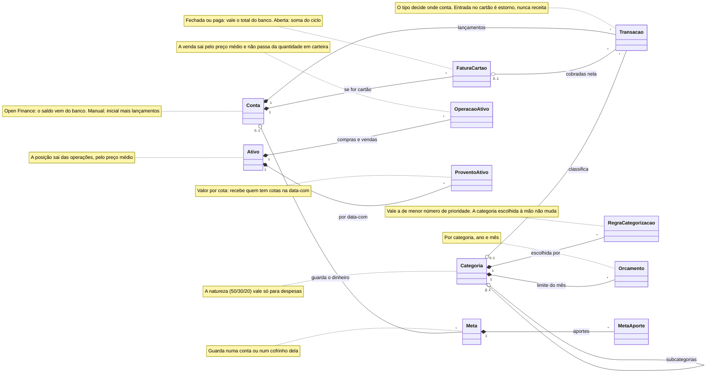

# Domínio

Os estados pelos quais as coisas passam, as classes do centro do domínio e os termos usados no código. As colunas estão no [modelo de dados](../BANCO-DE-DADOS.md#o-modelo-em-diagramas). O padrão dos diagramas está na [ADR 0055](../adr/0055-documentacao-de-arquitetura-em-diagramas-mermaid.md).

> **Data dos diagramas:** 31/10/2026. As regras valem nas duas linguagens, então o desenho sobrevive à troca para Go. Só a linha "Onde está hoje" de cada parte muda.

## Estados

### Conexão com a Pluggy

**Onde está hoje:** .NET, em `Servicos/Pluggy/SincronizacaoService.cs` e `Controllers/OpenFinanceController.cs`.

O sistema não decide o status: a cada sincronização, ele grava o que a Pluggy informar, em `Status` e `StatusExecucao`. Por isso, o diagrama mostra o que o site faz com cada valor, e não a ordem em que a Pluggy passa por eles.

| Status da Pluggy | O que a tela mostra (`configuracoes.component.ts`) | Alerta no Painel (`OpenFinanceController.Status`) |
|---|---|---|
| `UPDATED` | Atualizada | Não |
| `UPDATING` | Atualizando… | Não |
| `OUTDATED` | Desatualizada | Não |
| `LOGIN_ERROR` | Erro de login no banco | Sim |
| `WAITING_USER_INPUT` | Precisa de ação sua | Não |
| `WAITING_USER_ACTION` | Precisa de ação sua | Sim |

- **Erro e consentimento são independentes:** a conexão pode estar nos dois alertas ao mesmo tempo.
- **Desativada:** fica fora da sincronização, do status e dos investimentos (`Where(c => c.Ativa)`). `AlterarAtiva` liga e desliga.
- **`DiasAvisoConsentimento`:** parâmetro de 1 a 120 dias, com padrão 30 (`Servicos/ParametroService.cs`).

### Transação

**Onde está hoje:** a sincronização, em .NET (`Servicos/Pluggy/SincronizacaoService.cs`). A leitura e a edição, em Go (`internal/extrato`).

- **Quando a Pluggy manda a mesma transação de novo:** o sistema atualiza pelo `PluggyTransactionId`. Valor, data e status vêm da Pluggy. A categoria só muda se não foi escolhida à mão (`CategoriaManual`), e o nome só muda se ele veio automático.
- **Sumiu da Pluggy:** foi cancelada ou efetivada com outro Id, e a pendente é apagada (`pendentesRemovidas`).
- **Pendente mais antiga que o período buscado:** `RemoverPendentesJaEfetivadasAsync` procura uma efetivada de mesmo valor, de 2 dias antes a `DiasPendenteEfetivada` (10) depois, e apaga a pendente.

### Conta a pagar

**Onde está hoje:** .NET, em `Controllers/PlanejamentoControllers.cs` (`Pagar`), `Servicos/ContaAgendadaService.cs` (`ConciliarAsync`) e `Controllers/PainelController.cs` (`AlertasAsync`).

- **Paga:** pelo botão (`Pagar`) ou pela cobrança que chegou no extrato (`ConciliarAsync`, débito automático e cartão, de 10 dias antes do vencimento em diante).
- **Próximo vencimento:** `ProximoVencimentoApos`: mais um mês na `Mensal`, mais um ano na `Anual`, nenhum na `Unica`.
- **Encerrada:** não há próximo vencimento, ou ele passou da `DataLimite` (#69).
- **Outro aviso:** a cobrança automática que não apareceu dias depois do vencimento ("nao-veio", em `AvisosAsync`).

### Gerenciador

**Onde está hoje:** a referência é o gerenciador em Go ([ADR 0052](../adr/0052-gerenciador-em-go-com-bandeja-e-pagina-local.md)), em `src/gerenciador-go/internal/tela/tela.go`, `internal/situacao/situacao.go` e `versao_nova.go`. O de C# ainda é o que o instalador leva.

A situação do site:

A versão nova, só na instalação pelo `.msi`:

## Classes do domínio

Só o centro do domínio: quem pertence a quem e a regra principal de cada um.

| Parte | Onde está hoje |
|---|---|
| Conta, fatura, transação, categoria e regras | Go, atendendo o site |
| Ativo, operação e provento | Go pronto, desligado no site até a troca dos segredos; .NET atende |
| Orçamento e meta | .NET (#79) |

## Termos para quem desenvolve

O [glossário do site](../../src/frontend/src/app/compartilhado/glossario.ts) explica o termo para quem usa ([ADR 0020](../adr/0020-glossario-unico-com-balao-na-top-layer.md)). Esta lista diz onde ele está no código, sem repetir a definição. Termo novo do domínio entra aqui.

| Termo | No código | Regra principal | No glossário |
|---|---|---|---|
| Fatura do mês | `FaturaMesDto` (C#), `faturas.DoMes` (Go) | A fatura que fecha no mês escolhido, a mesma no Painel e em Contas | `faturaDoMes` |
| Dívida total | `CartaoConferenciaDto.DividaTotal`, `conferenciabanco.CartaoDto` | O saldo negativo do cartão, com as parcelas futuras; nunca abaixo de zero | `dividaCartao` |
| Natureza do gasto | `NaturezaGasto`, `Categoria.Natureza` | Essencial ou estilo de vida, para a regra 50/30/20 | — |
| Preço médio | `Posicao.PrecoMedio`, `carteira.Calcular` | Custo ÷ quantidade. A venda não muda o preço médio | `precoMedio` |
| Provento | `ProventoAtivo`, `ProventoRecebido` | O previsto vem da data-com; o recebido, do extrato | `dy` |
| Troco | `creditoDeOperacao`, `ClassificarTrocosSemDuvida` | Crédito da corretora que volta de uma compra: não é rendimento (ADR 0044) | `trocoDeCompra` |
| Transferência entre contas próprias | `Transacao.TransferenciaGrupo`, `internal/transferencias` | Só ela fica fora dos relatórios ([ADR 0031](../adr/0031-transferencia-fora-dos-relatorios-so-entre-contas-suas.md)) | — |
| Estorno | `TipoPeloSinal`, `AplicarTipo` | Entrada no cartão abate o gasto, sem virar receita ([ADR 0036](../adr/0036-receita-e-despesa-pelo-tipo-estorno-abate-gasto.md)) | — |
| Emergência | `Transacao.Emergencia` | Gasto marcado à mão, destacado nos relatórios e orçamentos | `reservaEmergencia`, para a reserva |
| Reserva | `ReservaDto`, `internal/reservas` | Dinheiro separado dentro de uma conta ([ADR 0010](../adr/0010-reservas-estimadas-pelo-extrato.md), [0037](../adr/0037-reservas-pelo-valor-do-open-finance.md)) | — |
| Conta a pagar | `ContaAgendada` | Compromisso com vencimento e recorrência; não confundir com `Conta` | — |
