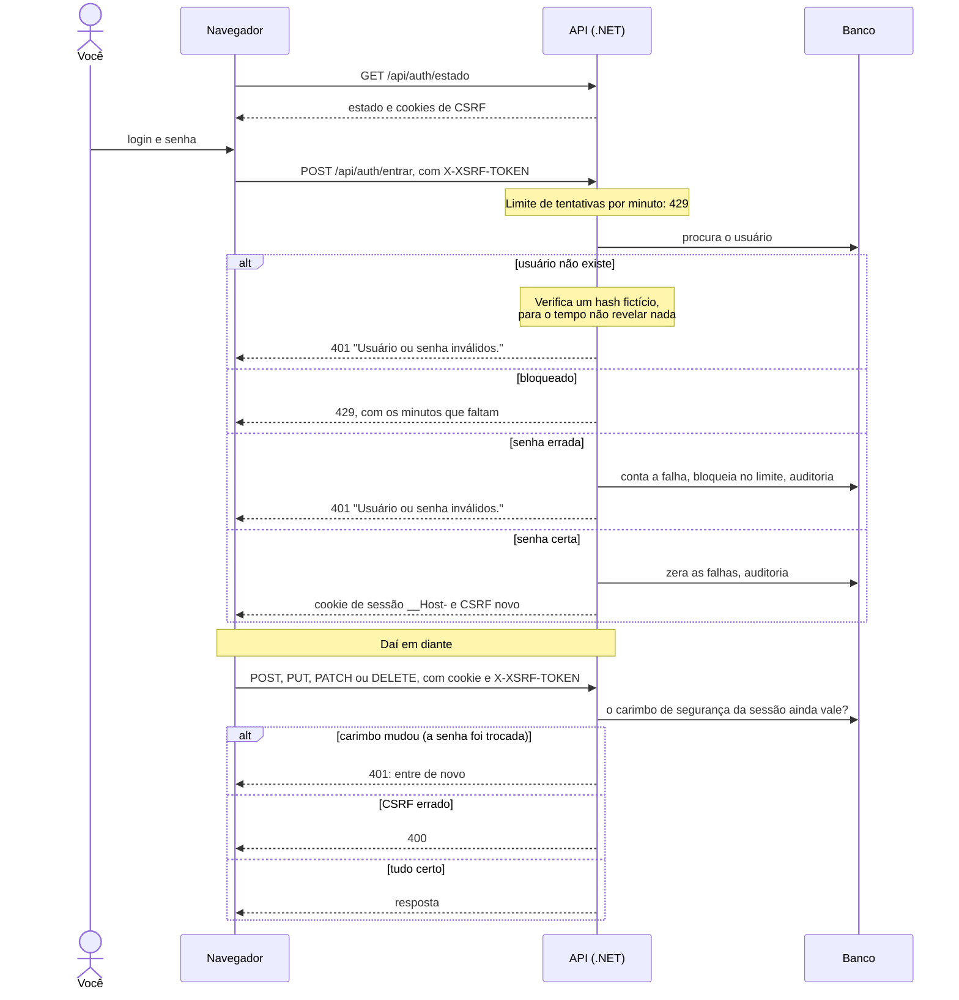
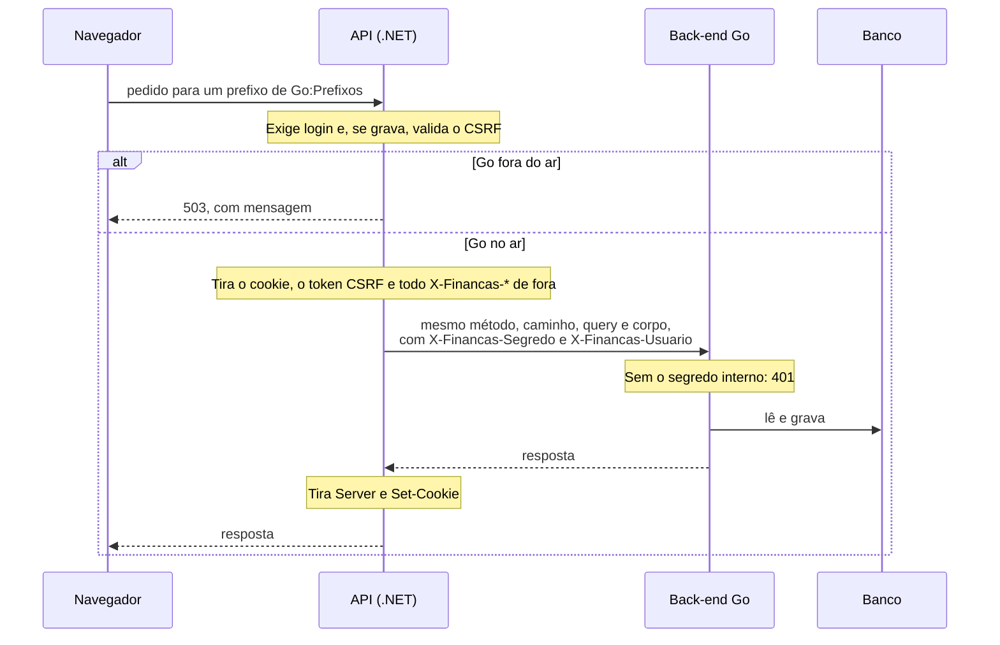
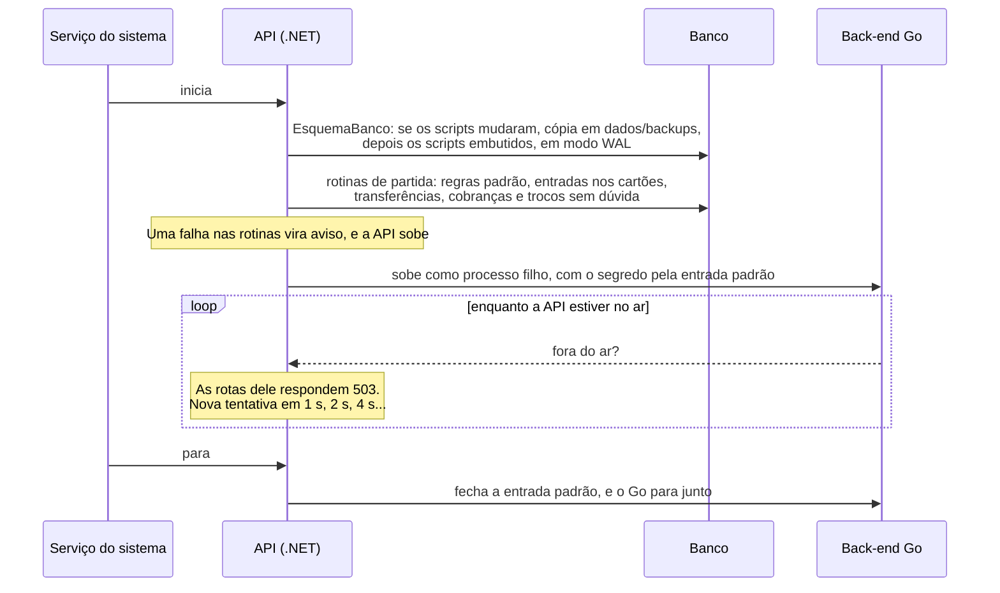
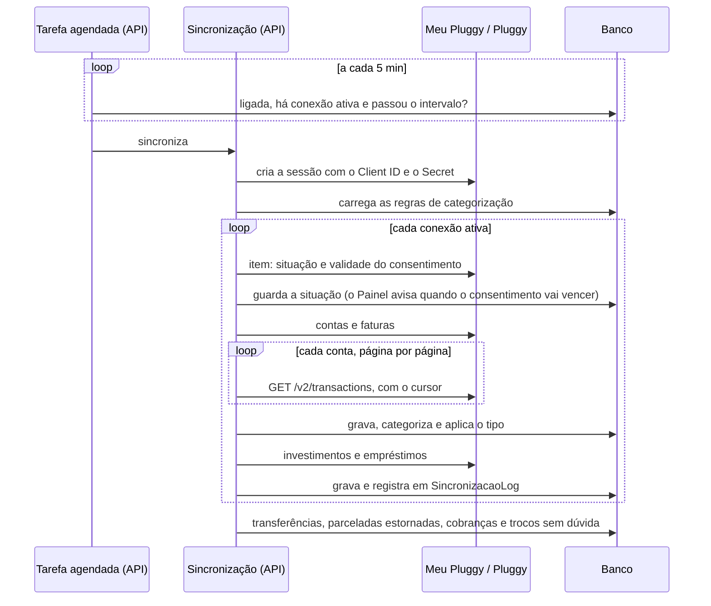
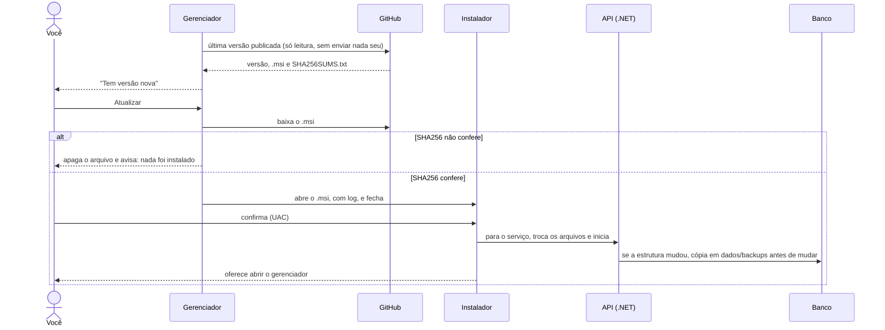

# Fluxos principais

Como as partes conversam nos caminhos que cruzam o sistema. Os nomes dos participantes são os do [diagrama de Contêineres](../ARQUITETURA.md#contêineres). O padrão está na [ADR 0055](../adr/0055-documentacao-de-arquitetura-em-diagramas-mermaid.md).

> **Data dos diagramas:** 01/11/2026, na fase "Go atrás do .NET" (#231). Cada fluxo diz quem atende hoje. Quando um assunto passa para o Go, o fluxo dele muda no mesmo PR.

## Login e sessão

**Quem atende:** a API .NET, até a inversão (#85).

- A senha fica com hash PBKDF2 (ASP.NET Identity), e os limites são parâmetros em **Configurações**.
- A sessão expira sem uso, e cada pedido renova o prazo.

## Pedido repassado ao Go

**Quem atende:** a API recebe, e o Go responde o que está em `Go:Prefixos`: câmbio, cripto, cadastros, contas, conferir com o banco e transações ([ADR 0049](../adr/0049-back-end-em-go-trocado-aos-poucos-atras-do-dotnet.md)).

## Partida da API

**Quem atende:** a API .NET. As seis rotinas de partida já existem em Go (`internal/partida`, #444), cada uma com a regra no pacote do assunto dela, mas só rodam com o Go na frente (opção `-rotinas-de-partida`, depois da inversão, #85). Atrás do .NET, quem as roda é o .NET: rodar nos dois seria acertar duas vezes.

## Sincronização com a Pluggy

**Quem atende:** a API .NET, até a #83.

- O intervalo vem de **Configurações**, entre 1 e 48 horas, e o padrão é 6.
- Um erro ao classificar os trocos não desfaz a sincronização: o troco continua na conferência.

## Atualização pelo gerenciador

**Quem atende:** o gerenciador do Windows, em C# ([ADR 0028](../adr/0028-gerenciador-do-windows-e-atualizacao-pelo-github.md)). A cópia do banco é feita pela própria API, ao iniciar a versão nova.

Se algo falhar: [Atualização que falhou](../OPERACAO.md#atualização-que-falhou).
