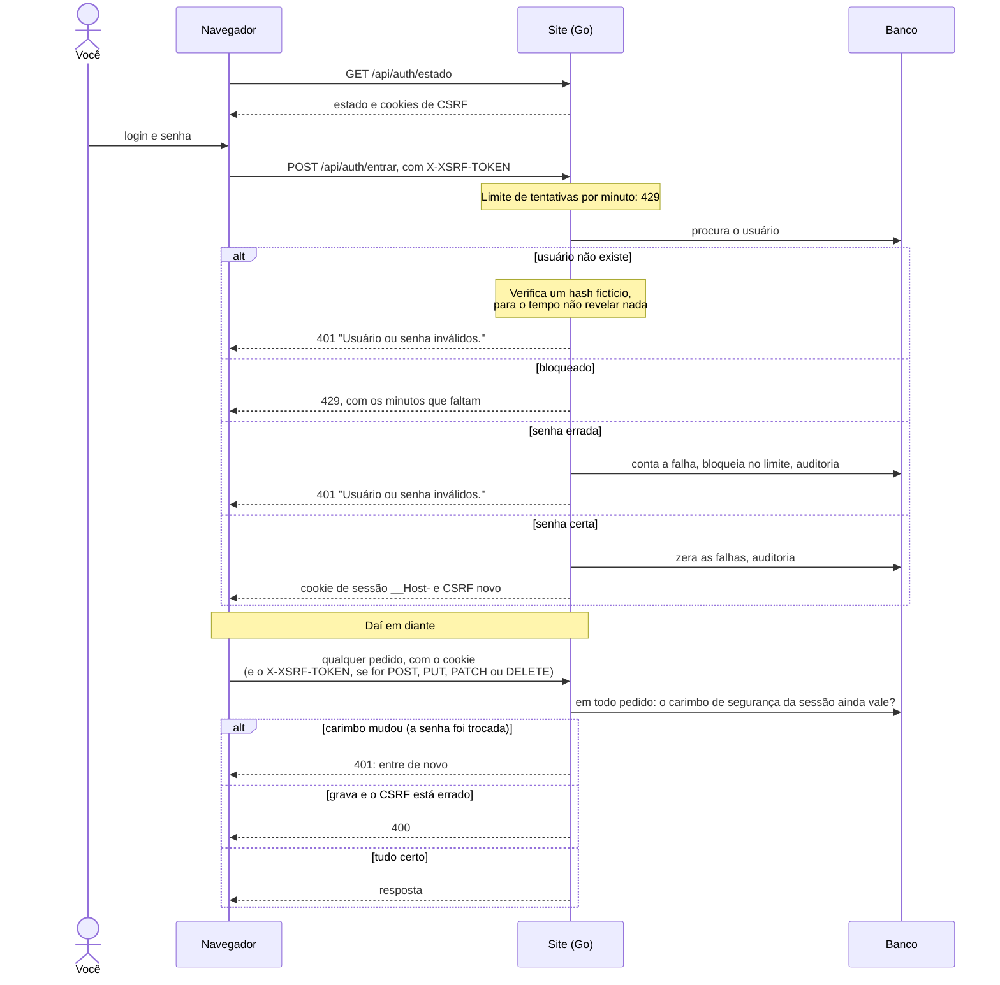
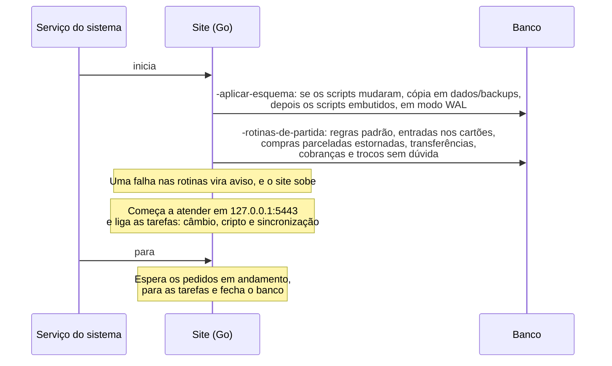
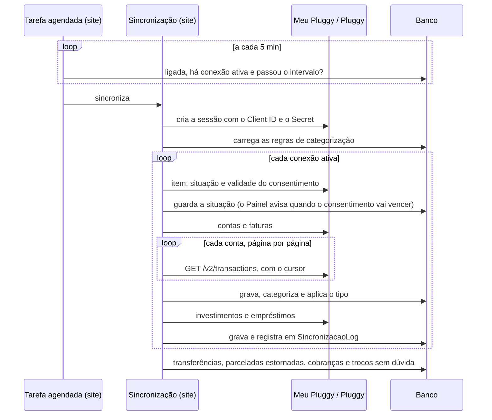
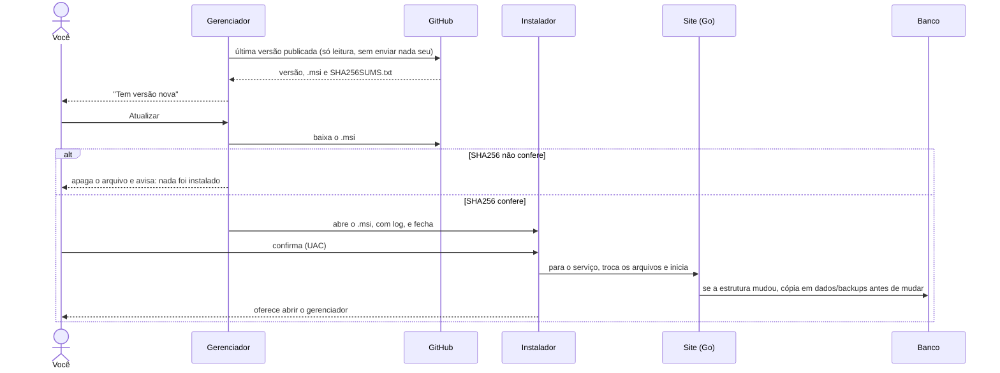

# Fluxos principais

Como as partes conversam nos caminhos que cruzam o sistema. Os nomes dos participantes são os do [diagrama de Contêineres](../ARQUITETURA.md#contêineres). O padrão está na [ADR 0055](../adr/0055-documentacao-de-arquitetura-em-diagramas-mermaid.md).

> **Data dos diagramas:** 03/11/2026, com o .NET já fora (#86): quem atende tudo é o site em Go. Quando um fluxo muda, o diagrama dele muda no mesmo PR.

## Login e sessão

**Quem atende:** o site (`internal/autenticacao`, #75).

- A senha fica com hash PBKDF2, no formato do ASP.NET Identity que o .NET usava, para as senhas de antes continuarem valendo. Os limites são parâmetros em **Configurações**.
- A sessão expira sem uso, e cada pedido renova o prazo.

## Partida do site

**Quem atende:** o site, com a linha do serviço instalado (`financas-go -aplicar-esquema -rotinas-de-partida`).

## Sincronização com a Pluggy

**Quem atende:** o site (`internal/sincronizacao`, #83).

- O intervalo vem de **Configurações**, entre 1 e 48 horas, e o padrão é 6.
- Um erro ao classificar os trocos não desfaz a sincronização: o troco continua na conferência.
- A sincronização da tela e a da tarefa são a mesma instância, com uma trava de uma rodada por vez.

## Atualização pelo gerenciador

**Quem atende:** o gerenciador em Go ([ADR 0052](../adr/0052-gerenciador-em-go-com-bandeja-e-pagina-local.md)). A cópia do banco é feita pelo próprio site, ao iniciar a versão nova.

Se algo falhar: [Atualização que falhou](../OPERACAO.md#atualização-que-falhou).
